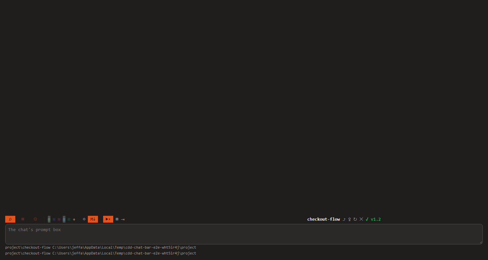
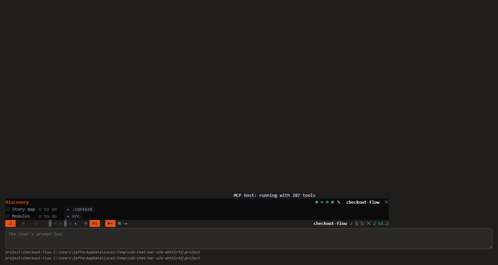
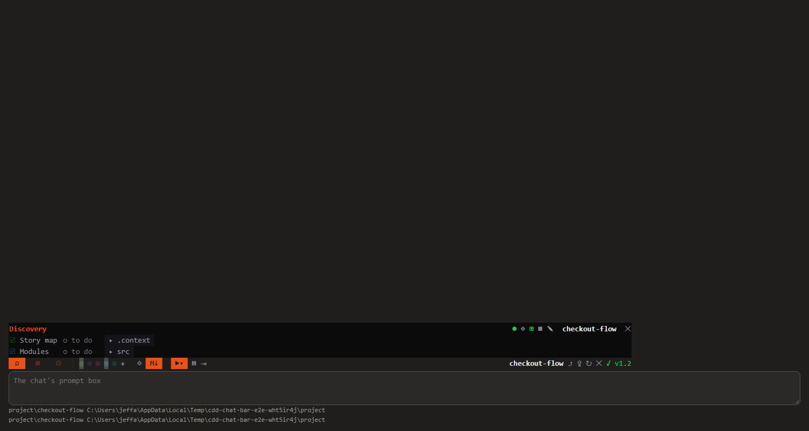
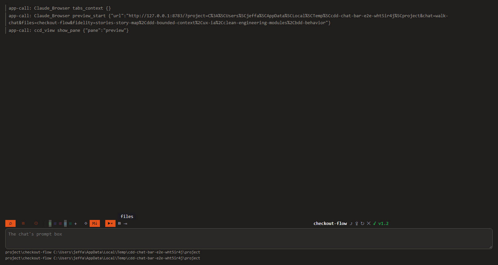

# Chat bar page walk

Walked 2026-11-21 by Lens through Playwright, in Chromium, on the chat bar's test page: the cdd-board mod's own code with a stand-in for the Claude app, asking a real cdd server about a throwaway git project whose chat has the session checkout-flow open. One screenshot a step. The mod was walked from a throwaway copy with one word changed, `this.selectedStages` to `this.shownStages` in `chat-bar-client.ts`: without it the bar draws only "chat bar failed to draw" (defect 1 below), and nothing else could be walked.

## Display Server Health Mark — Show the connected mark

**Given cdd answers server-health.report with 116 tools loaded**

- Seen: server-health.report answered; the server lists 287 tools; apps {'Graph': ('not running', None), 'Files': ('running', 8783), 'Kanban': ('not running', None), 'Story UI': ('not running', None)}
- Verdict: meets the intent (the live count stands for 116)

**When the Chat Bar draws the active session checkout-flow**

- Seen: the line above the prompt names 'checkout-flow'
- Verdict: meets the intent

**Then a green ✓ sits left of checkout-flow**

- Seen: the mark is '✓' in rgb(34, 197, 94), right of the session's name (mark at x=1124, name at x=944)
- Verdict: misses the intent: the ✓ is green but sits right of the session's name, after its buttons, near the right end of the line (finding 2)

## Open Server Health Panel — Show every part running on one line

**Given cdd is connected with 116 tools loaded, the Kanban app on port 8778 and the Graph app on port 5173**

- Seen: cdd is connected with 287 tools; the report gives {'Graph': ('not running', None), 'Files': ('running', 8783), 'Kanban': ('not running', None), 'Story UI': ('not running', None)}
- Verdict: misses the intent: the Kanban app and the Graph app do not run here, so the Given does not hold; Files reads running because the report found the person's own Files app on its usual port (finding 6)

**When the Person opens the server health panel**

- Seen: the health mark was pressed and a card opened above the line
- Verdict: meets the intent

**Then the session card opens with the panel on top, MCP host, Tools, Kanban app and Graph app green**

- Seen: the card's top line holds the parts [{'key': 'MCP host', 'text': '⬢', 'colour': 'rgb(34, 197, 94)'}, {'key': 'Graph', 'text': '◈', 'colour': 'rgb(155, 155, 168)'}, {'key': 'Files', 'text': '▣', 'colour': 'rgb(34, 197, 94)'}, {'key': 'Kanban', 'text': '▦', 'colour': 'rgb(155, 155, 168)'}, {'key': 'Story UI', 'text': '✎', 'colour': 'rgb(155, 155, 168)'}]
- Verdict: misses the intent as written: MCP host is green and the card opens with the parts on its top line, but there is no Tools part; the parts are MCP host, Graph, Files, Kanban and Story UI, green when running and grey when not (finding 3)

**And Tools reads 116 loaded, Kanban app 8778 and Graph app 5173**

- Seen: the card's words: ['Discovery', '⬢', '◈', '▣', '▦', '✎', 'checkout-flow', '✕']
- Verdict: misses the intent as written: no tool count and no port is written on the panel; the tool count shows in the MCP host tip on hover (finding 3)

**And no Hook server part shows**

- Seen: parts: ['MCP host', 'Graph', 'Files', 'Kanban', 'Story UI']
- Verdict: meets the intent

**And each part's name shows on hover**

- Seen: with the pointer on the first part, the tip shown reads ['MCP host: running with 287 tools']
- Verdict: meets the intent

## Open Server Health Panel — Pin the panel open

**Given cdd is connected and checkout-flow is the active session**

- Seen: card closed with its ✕; the line names checkout-flow; card showing: False
- Verdict: meets the intent

**When the Person presses the server health mark**

- Seen: the mark was pressed once; the card opened
- Verdict: meets the intent

**Then the session card and its panel stay open after the pointer leaves the mark**

- Seen: pointer on the prompt box; card showing: True
- Verdict: meets the intent

## Display Session Card — List each folder once

**Given checkout-flow is in Discovery with its five practices all writing under harness**

- Seen: checkout-flow is in Discovery with two practices on, Stories writing under .context and Clean Engineering under src
- Verdict: misses the intent as written: the seeded session has two practices and two folders, not five under one folder, so a folder repeated five times cannot show here

**When the Person opens the session card for checkout-flow**

- Seen: the card is open, pinned by the health mark
- Verdict: meets the intent

**Then harness is listed once, beside the first fidelity**

- Seen: folder chips: ['▸ .context', '▸ src']
- Verdict: meets the intent for what is seeded: each folder shows once

**And every fidelity of Discovery is still listed**

- Seen: fidelity lines: ['☑ Story map ○ to do', '☑ Modules ○ to do']
- Verdict: meets the intent

## Select Fidelity — Pick a fidelity from anywhere on its line

**Given the session card for checkout-flow is open**

- Seen: card showing: True
- Verdict: meets the intent

**When the Person presses the line of clean-engineering-model**

- Seen: pressed the right end of the Modules line, on its state text (clean-engineering-modules is this stage's Clean Engineering fidelity)
- Verdict: meets the intent

**Then the press covers the square, the name and the state, the whole line**

- Seen: the line's cell spans x 17 to 171; its button spans x 17 to 91
- Verdict: misses the intent: the button holds the square and the name only; the state words are outside it, and the press on them did nothing (finding 4)

**And clean-engineering-model is the fidelity the action button acts on**

- Seen: fidelities selected before the press: ['stories-story-map', 'clean-engineering-modules']; after: ['stories-story-map', 'clean-engineering-modules']; generate's command after: '/actions-generate stories-story-map clean-engineering-modules session=.sessions/checkout-flow/session.json format=markdown'; card showing: True
- Verdict: misses the intent as written: the press on the state changed nothing, and a press on the name turns the practice on or off for the session rather than choosing one fidelity for the action button (finding 4)

## Open Stage Files From Chat Bar — Open the files beside the chat, never in it

This story's desktop story test sits under review-generated-work-in-file-viewer; it is walked here because the button is the chat bar's.

**Given checkout-flow's Discovery stage holds the fidelities stories-story-map and ddd-bounded-context**

- Seen: the stage shown holds ['stories-story-map', 'clean-engineering-modules']
- Verdict: meets the intent (the session's own fidelities stand for the two named)

**When the Person opens the stage's files from checkout-chat's chat bar**

- Seen: the ▤ files button was pressed; waited 20 seconds
- Verdict: meets the intent

**Then the Files app opens beside the chat, naming checkout-flow and checkout-chat**

- Seen: what the bar sent the chat and the app: ['Claude_Browser tabs_context {}', 'Claude_Browser preview_start {"url":"http://127.0.0.1:8783/?project=C%3A%5CUsers%5Cjeffa%5CAppData%5CLocal%5CTemp%5Ccdd-chat-bar-e2e-wht5ir4j%5Cproject&chat=walk-chat&files=checkout-flow&fidelity=stories-story-map%2Cddd-bounded-context%2Cux-ia%2Cclean-engineering-modules%2Cbdd-behavior"}', 'ccd_view show_pane {"pane":"preview"}']; the band's words now: ['⌕', '▤', '⚙', '│', '■', '■', '■', '■', '■', '+', '◇', 'M↓', '▶', '▾', '▤', 'files', '⇥', 'checkout-flow', '⤴', '⇪', '↻', '✕', '✓', 'v1.2']
- Verdict: meets the intent: the bar asked the app's Browser pane to open the Files app on a link naming the project, the chat, checkout-flow and every fidelity of the stage, those of practices that are off among them, then to show the pane; nothing was added to the chat. The Files app's own page is not part of this page (findings 5 and 6)

## Findings

1. **The chat bar fails to draw on this branch (product defect, not fixed).** `ChatBarClient.stages`
   (`harness/chat-ui/pane/hooks/chat-bar/chat-bar-client.ts` line 98) reads `this.selectedStages`, which commit
   7e8473db9 (2026-11-21) removed when it renamed the getter to `shownStages`. Once the board answers with its columns
   the draw throws, and the band shows only "chat bar failed to draw: Cannot read properties of undefined (reading
   'includes')" in red. The page showed exactly that on its first run with the mod unchanged. The fix is the one word
   the walk's throwaway copy changed. main still has `selectedStages`, so main is not affected.
2. **The health mark sits right of the session's name, not left.** The scenario Show the connected mark says "a green
   ✓ sits left of checkout-flow". The line draws the stage buttons, dots, chips and action first, then the session's
   name, its push and restart buttons, then the ✓ and the version. Either the scenario is out of date or the mark
   moved; the story map's note on the mod says the bar "starts with the server health mark".
3. **The server health panel is not the one the scenarios describe.** Show every part running on one line names MCP
   host, Tools, Kanban app and Graph app, with "116 loaded" and each port written out. The panel is a line of icons on
   the session card: MCP host, Graph, Files, Kanban and Story UI, with no Tools part and no count or port written; the
   count shows only in the MCP host tip on hover ("MCP host: running with 287 tools").
4. **A fidelity's line is not pressable along its whole length, and the press does not pick a fidelity.** Pick a
   fidelity from anywhere on its line says the press covers the square, the name and the state, and makes that fidelity
   the one the action button acts on. In the code (`session-card-view.tsx`, `FidelityCellView`) the button holds the
   square and the name only, the state words are outside it, and the press toggles the fidelity's practice for the
   session (`session.toggle_guidance` with `practice`). The walk's press on the state words changed nothing. This is
   the defect of 2026-11-07 the scenario was written for, back again, or the scenario is out of date since the dots
   became practice toggles.
5. **The files button did what its scenario says.** It asked the app's Browser pane for the Files app on a link naming
   the project, the chat, the session and every fidelity of the stage shown, then asked for the pane to be shown.
6. **The page reads the person's own app servers.** `server-health.report` looks for each app on its usual port on
   this computer, so the test's cdd server reported the person's running Files app (port 8783) as running, and the
   files button's link pointed at it. A browser story test must not rely on which apps happen to run; the tests below
   assert only what does not depend on it.

Not walked: Open Prompt Queue. The prompt queue is another mod (`tools/prompt_queue`), which this page does not load.
