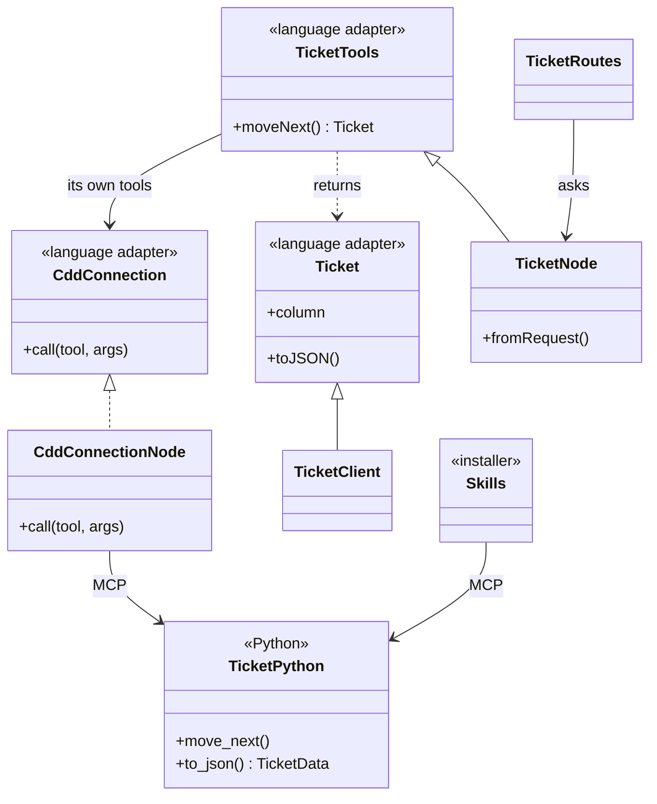
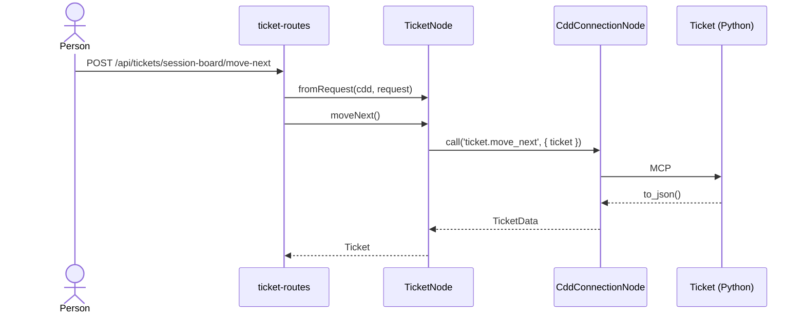

## Overview

How anything outside Python reaches the **CDD domain**. The domain, its rules, and its state stay in Python. Skills, actions, and commands reach it through MCP tools. TypeScript reaches those same tools through a **language adapter**, which the installer deploys beside the skills and MCP operations.

**This pattern is only the access.** It says nothing about screens or stacks. Pair it with what the application is built in: `patterns-lern-domain-driven` for a web app, `patterns-cdd-claude-mod` for a Claude Code mod. The Session Board in `harness/kanban/app/` is the worked example.

**No god connector.** Each domain object has its own class that knows its own tools. `TicketTools` calls `ticket.move_next`, and `BoardTools` calls `board.show`. One connection underneath carries the calls and knows no tool by name.

**No fidelity progression of its own.** Every run works one domain object through the layers below, Python first.

| Layer | File | Role |
|---|---|---|
| Domain | `harness/<domain>/*.py`, `space/<domain>/*.py` | The Python classes. Every rule, decision, and piece of state lives here. |
| Tool | The same file, marked `@mcp @agent_tool` | One operation for each thing a person or agent does. The tool reads `{object}.{operation}`. |
| Contract | `{Object}Data`, a `TypedDict` that `to_json()` is annotated with | The only agreement between the languages. The language adapter is written from it. |
| Mark | `@language_adapter(language="typescript")` on the class | Opts the toolset in to the language adapter. |
| Language adapter | `<install path>/language-adapters/typescript/<source folders>/<object>.ts` | Written by the installer, never edited. Holds `{Object}Data`, the `{Object}` class that reads it, and `{Object}Tools` with one typed operation for each tool. |
| Connection | `src/cdd/cdd-connection-node.ts` | `CddConnectionNode implements CddConnection`. Starts one cdd server and carries calls. Knows no tool by name. |
| Node | `src/<context>/<object>/<object>-node.ts` | `{Object}Node extends {Object}Tools`. Adds what generation cannot know, such as parsing a request. The server-side object everything on the server talks to. |
| Client | `src/<context>/<object>/<object>-client.tsx` | `{Object}Client extends {Object}`. Reads the same structure in the browser. |





---

## Guidance

Enforceable rules live in **§ Shared rules** below. This section explains how they apply; do not treat guidance bullets as a second rule list.

### Every door reaches the same tool

A person typing a slash command, an agent calling a tool, and a person pressing a button in a web app all reach one MCP tool, and the tool calls one domain operation. Because they share that tool, what the board shows and what the agent does cannot disagree.

| Door | Reaches the tool through |
|---|---|
| Skill, action, or command | The agent calls the MCP tool |
| Claude Code mod | `$.mcp.call`, typed by the language adapter, as `patterns-cdd-claude-mod` describes |
| TypeScript server | `{Object}Tools`, from the language adapter |

### One straight line

An action reads the same from the route to the domain, so anyone can follow it by searching one word.

| Route | Node | Tool | Domain |
|---|---|---|---|
| `POST /tickets/:ticket/move-next` | `TicketNode.moveNext()` | `ticket.move_next` | `Ticket.move_next()` |
| `POST /tickets/:ticket/practice` | `TicketNode.enablePractice(practice, isEnabled)` | `ticket.enable_practice` | `Ticket.enable_practice(practice, is_enabled)` |

### The language adapter is a deployment target

The installer treats a language adapter as one more channel, beside skills, commands, rules, MCP, and hooks. It walks the same toolsets, reads the same marks, tracks what it writes so `clean` removes it, and reports it in `diagnostics.json`. Like the rest of the install it is generated, never edited, and not committed, so run the installer on a fresh clone before building.

```python
@language_adapter(language="typescript")
@agent_toolset
class Ticket(Card):
    def to_json(self) -> TicketData: ...
```

```
.claude/language-adapters/typescript/
├── cdd-connection.ts            the connection type, with no package dependency
├── harness/kanban/
│   ├── board.ts                 BoardData, Board, BoardTools
│   ├── ticket.ts                TicketData, Ticket, TicketTools
│   └── backlog-item.ts
└── space/session/session.ts
```

The folders mirror the toolset's source. Only marked toolsets are written, so catalog pages, rules, and guidance prose never appear here. **Mark a toolset when an application needs its results as data.** A toolset that returns prompt text for an agent to follow, as the practices and actions do, gains little from a typed wrapper, so it stays unmarked.

Import it through the `@cdd` path alias, which points at the install. The adapter imports no package, so a browser bundle can import `Ticket`, and only a server builds on `TicketTools`.

```ts
export class Ticket {
  constructor(protected readonly data: TicketData) {}

  toJSON(): TicketData {
    return this.data
  }

  get isDone(): boolean {
    return this.data.is_done
  }
}

export class TicketTools {
  constructor(protected readonly cdd: CddConnection, protected readonly ticket: string) {}

  async moveNext(): Promise<Ticket> {
    return new Ticket(await this.cdd.call<TicketData>('ticket.move_next', { ticket: this.ticket }))
  }
}
```

- The `@tool_subject` loader's argument is held by `{Object}Tools`, so a caller names the object once.
- A Python `@classmethod` operation becomes a `static` operation that takes the connection, because no loaded object runs it.
- A result naming one marked class comes back as that class. A choice of objects stays as their data.
- `toJSON()` returns exactly what Python sent, so a route can answer with the object itself.

### Python states the contract

`{Object}Data` is a `TypedDict` the domain class annotates `to_json()` with, so the shape is written once, in Python, and TypeScript follows. A plain `dict[str, Any]` generates `Record<string, unknown>`, which the compiler cannot check. `NotRequired` becomes an optional field, and `str | None` a nullable one. Fields keep Python's `snake_case` in `{Object}Data`, because it states exactly what `to_json()` returns and some keys are data, such as a fidelity named `story_map`. The `{Object}` class exposes `camelCase` getters, and the rest of the TypeScript reads those.

### What an application adds

The adapter has every tool, so `{Object}Node` holds only what generation cannot know: how a request becomes arguments, and any order of work this application needs.

```ts
const TicketAddress = z.object({ ticket: z.string().min(1) })

export class TicketNode extends TicketTools {
  static fromRequest(cdd: CddConnectionNode, request: Request): TicketNode {
    return new TicketNode(cdd, TicketAddress.parse(request.params).ticket)
  }
}
```

`<object>.ts` in the application is optional. It holds small logic the browser and server share that Python does not, such as an address made from two fields. If a line decides what is true or what may happen, it belongs in Python. If it only shapes something, it belongs here or on the client.

### State stays behind the tool

An application keeps no copy of what the domain owns. There is no repository, no lowdb store, and no cache for a CDD object, because a second copy drifts from the first and the agent changes state without telling the application. To stay current, read through the tool again.

**lowdb is for state CDD does not own.** A web app built in LERN still uses lowdb for what belongs to that app alone, such as a person's saved layout. `patterns-lern-domain-driven` applies in full to those aggregates. For an aggregate backed by CDD, its persistence rules do not apply and the language adapter takes the repository's place.

| LERN | For a CDD-backed aggregate |
|---|---|
| `{Domain}` holds the business rules | The adapter's `{Object}` holds structure; the rules are in Python |
| `{Domain}Node extends {Domain}` | `{Object}Node extends {Object}Tools`, which returns `{Object}` |
| `{Domain}Client extends {Domain}` | `{Object}Client extends {Object}` |
| `{Domain}Repository`, `{Domain}RepositoryNode`, `<aggregate>.json` | **None.** The tool is the store |
| Zod `.parse()` when writing the store | Zod `.parse()` on what a request sent. Python validates what is written |

### When a call fails

The MCP server answers a failed operation with plain text, such as `TicketNotFoundError: no ticket x`, and it does not always set `isError`. Every successful operation returns JSON, so `CddConnectionNode` treats text that is not JSON as a failure and raises `CddToolError` with that text. A route's error handling shows it to the person.

### Testing architecture

The BDD tiers in `patterns-lern-domain-driven` apply, with these meanings for a CDD-backed object.

| Tier | Driver calls | Runs against |
|---|---|---|
| Domain | Usually skipped: the core holds little | Nothing |
| Server | `{Object}Node` | The real cdd server on a throwaway project |
| Playwright | The page | API answers from examples |
| E2e | The page | The real server and cdd on a throwaway project |

The Python domain keeps its own Mamba specs, and `{object}.{operation}` keeps its tool spec. A behavior both languages state keeps the same `should` sentence, so a sentence on one side only shows what is untested on the other.

---

## Generate

1. Follow **session_guidance**. Start from the Python: name the classes this slice exposes, read their `.context/`, and list their `@mcp @agent_tool` operations.
2. Add any missing domain operation and its Mamba spec first. Annotate `to_json()` and each operation's result with a `TypedDict`, and mark the class with `@language_adapter(language="typescript")`.
3. Run `python scripts/install.py --ide Claude`. The language adapter follows, with the skills, commands, and MCP entry.
4. Point the `@cdd/*` path alias at `<install path>/language-adapters/typescript/`.
5. Scaffold `src/cdd/cdd-connection-node.ts` from `templates/` once per application.
6. Write `<object>-node.ts`, then `<object>-routes.ts` asking it.
7. Write the tests as the BDD tiers describe, server tier first.
8. Run the type-check, the tests, and validate. If validate fails, fix and validate again until it passes.

## Shared rules

```yaml
alwaysApply: false
globs: "**/*-routes.ts,**/*-node.ts,**/cdd-connection-node.ts"
```

Whenever you create, alter, or delete code outside Python that reaches the CDD domain, or the MCP tools it calls. Follow these rules.

If this change will not stay here, follow `practices/clean-engineering/clean-engineering-code.mdc`. The `practices/ddd/ddd-tactics.mdc` rules apply to the Python domain classes.

### Domain and state

- **`domain-lives-in-python`** — Put every rule and decision in the Python domain class: what a state means, whether an action is allowed, what comes next. A rule written in TypeScript is lost to the agent's tools and to every other door.
- **`state-lives-behind-the-tool`** — Get every fact about a CDD object from its tool, and keep no repository, store, or cache of it. The agent changes that state without telling the application, so a copy goes stale.
- **`lowdb-only-for-what-cdd-does-not-own`** — Use lowdb only for state that belongs to the application alone, so one fact has one home.
- **`core-holds-only-shared-logic`** — `<object>.ts` in the application holds logic the browser and server share that Python does not. If the line decides what is true, it belongs in Python.

### One object, one class

- **`one-class-per-object`** — Each domain object has its own class that calls only that object's tools, and a node calls the operations it inherits. A single connector that knows every tool becomes the place everything changes and hides which object owns which operation.
- **`adapter-is-generated`** — The installer writes `{Object}Tools`, and nobody edits it or writes one by hand. A hand-kept class drifts from Python, and the compiler then checks the wrong thing.
- **`mark-toolsets-that-return-data`** — Mark a toolset with `@language_adapter` when an application needs its results as data. Marking one that returns prompt text adds a wrapper nobody can type.
- **`node-extends-the-adapter`** — `{Object}Node` extends `{Object}Tools` and adds only what generation cannot know. Everything on the server then has one object to talk to.
- **`connection-only-carries`** — `CddConnectionNode` starts the server and carries calls, and it names no tool. A tool name there is an operation that belongs on its object.
- **`routes-ask-the-object`** — A route asks `{Object}Node` and never calls a tool. A route that calls a tool has skipped the object's typed operation.

### One line from door to domain

- **`one-line-to-the-domain`** — One operation calls one MCP tool, which calls one domain operation. Work spanning several calls belongs in a domain operation, so an agent and a person get the same result.
- **`tool-matches-the-object`** — Name the toolset after the Python object it acts on, so the tool reads `ticket.move_next`. A tool named after the component gathers every object's operations into one class.
- **`same-verb-across-layers`** — Use the same verb and noun from route to domain: `moveNext`, `ticket.move_next`, `Ticket.move_next`. A reader can then follow an action by searching one word.
- **`preserve-arg-names-across-layers`** — Argument names stay the same across layers, with only the casing changing. Renaming at a boundary hides which value is which.
- **`tool-stays-thin`** — A tool finds the domain object, calls one operation, and returns `to_json()`. Logic in a tool cannot be reached by anything that calls the domain directly.

### Contract and failure

- **`annotate-what-typescript-reads`** — Annotate `to_json()` and each MCP operation on a marked toolset with a `TypedDict`. A plain `dict[str, Any]` generates `Record<string, unknown>`, which the compiler cannot check.
- **`property-casing-transform`** — `snake_case` in Python and `{Object}Data`, `camelCase` on the `{Object}` getters and operation arguments. The adapter converts once, so the rest of the code sees one spelling.
- **`text-that-is-not-json-is-a-failure`** — `CddConnectionNode` raises `CddToolError` on an answer that is not JSON. The MCP server sends a failed operation's error as plain text, so parsing it blindly replaces the real error with a syntax error.
- **`fail-loud-on-mcp`** — When a call fails or the server is missing, show the person what failed and how to fix it. Drawing old state as if it were current misleads them into acting on it.

### Testing

- **`server-tier-runs-cdd-for-real`** — The server tier calls `{Object}Node` against a real cdd server on a throwaway project. A stubbed tool would pass after the Python changed.
- **`act-on-a-throwaway-project`** — Any test that moves, closes, or commits runs on a throwaway project with no real remote, because these tools really commit and push.
