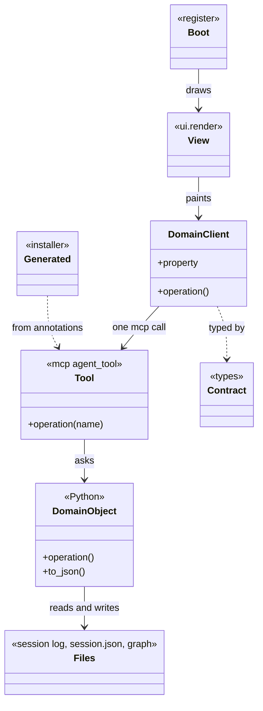
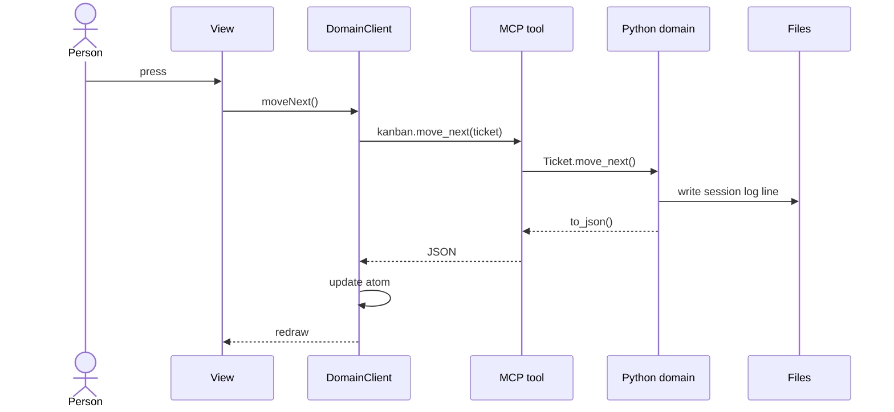

## Overview

Implementation fidelity for a **Claude Code mod that is a view of the CDD domain**. The story map, the module boundaries, and the canvas exist before this tool runs. The rules below are additive on top of what Stories, Clean Engineering, and BDD already enforce.

**The domain is CDD, and it is already in Python.** Sessions, the repository, output files, the knowledge graph, guidance, and actions all live in `harness/`, `space/`, and `cdd_guidance/`. A mod owns none of that. The Kanban is the first example: `harness/kanban/pane/` is a Claude Code view of `Session`, `Ticket`, and the actions that move work forward. A mod changes what a person sees beside the chat and what the agent is told. It never changes what is true.

**No fidelity progression of its own.** Every run works one domain component through the layers below, Python first.

Every domain component has the same pieces, and each piece has one job.

| Layer | File | Role |
|---|---|---|
| Domain | `harness/<domain>/*.py`, `space/<domain>/*.py` | The Python classes. Every rule and decision lives here. State is read from the files the work produced. |
| Tool | `harness/<domain>/<domain>.py` | `{Domain}` toolset. One `@mcp @agent_tool` operation per thing a person or agent does. Parses names, calls the domain, returns `to_json()`. |
| Generated | `.mcp.json`, `.claude/skills/`, `.claude/commands/` | Written by the installer from the tool's annotations. Never edited. |
| Contract | `pane/types/index.d.ts` | `{Domain}Json`, the shape `to_json()` returns, plus `PluginState` for every atom. |
| Client | `pane/hooks/<domain>/<domain>-client.ts` | `{Domain}Client`. Mirrors the Python object: properties to display, operations to act. Holds the mod's one `$.mcp.call`. |
| View | `pane/hooks/<domain>/<screen>-view.tsx` | `{Screen}View`. Paints a client. Decides nothing. |
| Surface module | `pane/hooks/<domain>/<part>.tsx` | A `ClientModule`, only for what a Button cannot do, such as a press anywhere on a card. |
| Boot | `pane/hooks/register.tsx` | The events: `session.start`, `ui.render`, `prompt.compose`, `command.run`, and the status line. Connects them to clients and views. |
| Manifest | `pane/.claude-plugin/plugin.json`, `pane/hooks/hooks.json` | Names the mod, its module, and its contract. |

1. A person presses something in a view.
2. The view calls an operation on `{Domain}Client`.
3. The client calls one MCP tool with `$.mcp.call`.
4. The tool loads the domain object and runs the operation of the same name.
5. The domain object writes what happened to the files it owns, the session log first.
6. The tool returns `to_json()`.
7. The client writes that JSON to its atom, and the write redraws every view that reads it.
8. The next draw builds a new client from the new JSON.





---

## Guidance

Enforceable rules live in **§ Shared rules** below. This section explains how they apply; do not treat guidance bullets as a second rule list.

### Same intention as LERN, different pieces

This pattern answers the questions `patterns-lern-domain-driven` answers: where a rule lives, what a view may do, and how one press reaches the domain. The pieces differ because the domain is already built in another language and the front end is a mod, not a browser.

| LERN | This pattern | Why it differs |
|---|---|---|
| `{Domain}` base class in TypeScript | The Python domain class | The domain exists. Copying it into TypeScript would give two places to change every rule. |
| `{Domain}Client extends {Domain}` | `{Domain}Client` mirrors what the mod needs | Two languages cannot share a base class, so `{Domain}Json` is the agreement between them. |
| `{Domain}Node` | The Python domain class | It already runs on the server side. |
| `{Domain}Repository`, `<aggregate>.json` | **None** | State comes from the files the work produced. The session reads its log and `session.json`, and the knowledge graph says which files that work made. There is no collection to load and save. |
| Express route file | `{Domain}` toolset with `@mcp` | The MCP tool is the route, and its annotations generate the skills and commands. |
| React state holding the client | An atom holding JSON | `$.state` outlives a hot reload, so it holds values, not instances of code that may have changed. |
| `*Node.destination` picks the next page | The domain names the next action | One pane has no paths. The next thing to do is domain data the view paints. |
| Zod `.parse()` on write | The domain class | Python validates. The contract types what comes back. |

### The Kanban, layer by layer

`harness/kanban/` is the worked example, and every new domain component follows it.

| Layer | In the Kanban |
|---|---|
| Domain | `Board`, `Ticket`, `Stage`, `BacklogItem` over `Session`, `Repo`, `Graph` |
| Tool | `Kanban` in `harness/kanban/kanban.py`: `board`, `move_next`, `move_previous`, `new`, `start`, `close`, `archive` |
| Generated | The `cdd` entry in `.mcp.json` and the `harness-kanban-*` skills |
| Contract | `TicketJson`, `BoardJson`, `ColumnJson` in `pane/types/index.d.ts` |
| Client | `BoardClient`, `TicketClient` in `pane/hooks/board/board-client.ts` (intended: today this code is free functions in `register.tsx`) |
| View | The column, card, and details functions in `register.tsx` (intended: `board-view.tsx`, `ticket-view.tsx`) |
| Surface module | `ticket-card.tsx`, `split-grip.tsx` |
| Boot | `register.tsx` |

### One straight line

A person's action reads the same from the button to the domain, so anyone can follow it by searching one word.

| View | Client | MCP tool | Tool operation | Domain |
|---|---|---|---|---|
| `onPress` | `ticket.moveNext()` | `kanban.move_next` | `Kanban.move_next(ticket)` | `Ticket.move_next()` |
| `onPress` | `ticket.archive()` | `kanban.archive` | `Kanban.archive(ticket)` | `Ticket.archive()` |

Rules `one-line-from-client-to-domain`, `same-verb-across-layers`, and `preserve-arg-names-across-layers` govern this line. A tool that coordinates more than one domain call has the wrong name or the domain is missing an operation.

### Mirror as needed

`{Domain}Client` mirrors the Python class's names, not the whole class. It carries a property only when a view paints it and an operation only when a person or the agent can trigger it. Keeping the rest in Python means a new domain rule needs no TypeScript. The test for a line of TypeScript: if it decides something, it belongs in Python. If it shapes something for display, such as a label, a colour, or an age, it belongs on the client.

### State is in the files

There is no repository and no cache to keep in step. The domain reads the session log, `session.json`, `.sessions/`, and the knowledge graph each time it is asked. The atom holds the last JSON a tool returned, so the pane can draw between calls. After a tool call, a prompt, or a session start, Boot asks for the board again, because work done by the agent changes the files without the mod knowing.

### Mod mechanics

- A hook is `($, e, next)`. `next(e)` runs the plugins beneath and the engine's own behaviour, so a hook that observes calls it and returns its result.
- `ui.render` receives one component and returns a tree. The elements come from `$.ui.resolve(e)`, because each surface has its own table.
- `atom`, `read`, and `update` hold what a drawing reads. `read` runs while drawing, `update` runs from a handler or another event, and the write redraws what reads it.
- Module variables start over on every reload. `$.state` stays, so a value whose shape changes declares `shape` to carry old values forward.
- Everything outside the module goes through `$`: `$.mcp.call`, `$.ui.status`, `$.ui.toast`, `$.prompt.fill`, `$.command.register`.
- A press inside a region needs a `ClientModule`, because a Button can hold text but no Box. It reports through `surface.post`.

### Testing architecture

Each layer is tested where its behaviour lives, so a rule is proved once.

| What | Where | Runs with |
|---|---|---|
| Domain rules | `harness/<domain>/<domain>_spec.py` | Mamba |
| Tools, through the toolset | `harness/<domain>/<domain>_tools_spec.py` | Mamba |
| Client and views | `pane/hooks/register.test.tsx` | `claude plugin test` |
| Module shape and engine refusals | The mod folder | `claude plugin validate` |
| Types | The mod folder | `tsc -p` |

### UX hand-off

The canvas and the story map are designed upstream by `ux` and `stories`. `generate` cites them under **Sources / context**; it does not call them.

---

## Generate

1. Follow **session_guidance**. Start from the domain: name the Python classes this slice works on and read their `.context/`.
2. Add any missing domain operation and its Mamba spec first. Specs first, small RED cycles.
3. Add the `@mcp @agent_tool` operation on the `{Domain}` toolset and its tool spec. Run `python scripts/install.py --ide Claude` so the generated skills, commands, and MCP entry follow.
4. Update `pane/types/index.d.ts` to the shape `to_json()` returns.
5. Add `{Domain}Client` properties and operations for what this slice displays and does, then the view that paints them. Scaffold from `templates/`.
6. Connect events in `register.tsx`.
7. Run `claude plugin validate`, `tsc -p`, and `claude plugin test` on the mod folder, and Mamba on the Python specs.
8. Run validate. If it fails, fix and validate again until it passes.

## Shared rules

```yaml
alwaysApply: false
globs: "**/pane/hooks/**,**/pane/types/**,**/pane/.claude-plugin/**"
```

Whenever you create, alter, or delete a Claude Code mod that views the CDD domain, or the MCP tools it calls. Follow these rules.

If this change will not stay here, follow `practices/clean-engineering/clean-engineering-code.mdc`. The `practices/ddd/ddd-tactics.mdc` rules apply to the Python domain classes.

### Domain and layout

- **`domain-lives-in-python`** — Put every rule and decision in the Python domain class: what a state means, whether an action is allowed, what comes next. A rule written in the mod is lost to every other IDE and to the agent's own tools.
- **`state-lives-in-the-files`** — Read state from the session log, `session.json`, `.sessions/`, and the knowledge graph through the domain, and add no repository class or cache. A second copy of the work's state drifts from what the work actually did.
- **`pane-lives-beside-its-domain`** — Keep a mod in `harness/<domain>/pane/`, beside the Python it views, so a change to the domain and its view is one reviewable change.
- **`domain-folder-in-the-mod`** — Put each domain component's client, views, and surface modules in `pane/hooks/<domain>/`, with `<domain>-client.ts` and kebab-case `<screen>-view.tsx`. One folder per component keeps `register.tsx` from becoming the whole mod.
- **`boot-only-in-register`** — `register.tsx` connects events to clients and views and holds nothing else, so the file a reader opens first shows what the mod reacts to.
- **`generated-never-edited`** — Change a tool's annotations and reinstall. `.mcp.json`, `.claude/skills/`, and `.claude/commands/` are written by the installer, so a hand edit is lost on the next install.

### Client and contract

- **`client-mirrors-python-domain`** — Name `{Domain}Client` and its members after the Python class, in camelCase, so one word finds the concept in both languages.
- **`mirror-only-what-the-mod-uses`** — Add a property only when a view paints it and an operation only when a person or the agent triggers it. Everything else stays in Python, because each mirrored member is one more thing to keep in step.
- **`contract-matches-to-json`** — `{Domain}Json` in `pane/types/index.d.ts` states exactly what `to_json()` returns. It is the only agreement between the two languages, so a change to one side changes the other in the same commit.
- **`client-shapes-for-display`** — A client may format: labels, colours, ages, and addresses. If the line changes what is true or what may happen, it belongs in Python.
- **`property-casing-transform`** — `snake_case` in Python and JSON, `camelCase` on the client. The client converts once, when it is built, so views never see two spellings.

### One line from view to domain

- **`one-line-from-client-to-domain`** — One client operation calls one MCP tool, which calls one domain operation. Work spanning several calls belongs in a domain operation, so the agent's tools and the mod do the same thing.
- **`same-verb-across-layers`** — Use the same verb and noun from client to domain: `moveNext`, `kanban.move_next`, `Kanban.move_next`, `Ticket.move_next`. A reader can then follow an action by searching one word.
- **`preserve-arg-names-across-layers`** — Argument names stay the same across layers, with only the casing changing. Renaming at a boundary hides which value is which.
- **`tool-stays-thin`** — A tool operation finds the domain object, calls one operation, and returns `to_json()`. Logic in a tool cannot be reached by anything that calls the domain directly.
- **`mcp-calls-only-on-the-client`** — `$.mcp.call` appears only in a client. Views and Boot call client operations, so there is one place to handle a failed call.
- **`fail-loud-on-mcp`** — When a call fails or the server is missing, show the person what failed and how to fix it. Drawing old state as if it were current misleads them into acting on it.
- **`every-action-reaches-the-agent-the-same-way`** — A person and the agent trigger the same MCP tool, so what the board shows and what the agent does cannot disagree.

### State and drawing

- **`atoms-hold-json`** — An atom holds the JSON a tool returned, and each draw builds a client from it. `$.state` outlives a reload, so an instance stored there would run old code.
- **`declare-every-atom`** — Declare each atom in `PluginState` in `pane/types/index.d.ts`, and give it a `shape` when its form changes. `claude plugin validate` holds the module to that contract, and old stored values reach new code.
- **`no-state-in-module-variables`** — Keep what a drawing reads in an atom. Module variables start over on every reload, so the pane would lose its place.
- **`refresh-on-engine-events`** — Boot refreshes the board on session start, prompt submit, and each cdd tool call. The agent changes the files without telling the mod, so the pane must ask.
- **`views-render-only`** — A view paints a client and calls its operations. It holds no `$.mcp.call`, no rule, and no atom write.
- **`resolve-elements-from-the-surface`** — Get elements from `$.ui.resolve(e)`. The module has no DOM, and each surface has its own table.
- **`size-to-the-pane`** — Size a tree to `e.props.bodyColumns`, which excludes what the engine draws over, so nothing is cut off.
- **`key-every-listed-button`** — Give every Button in a list its own `key`. A Button's key defaults to its label, and a surface finds a Button again by that key after a redraw.
- **`surface-module-for-region-press`** — Use a `ClientModule` only for what a Button cannot do. Its `surface.post` reports to the pane, and the pane calls the client, so the line stays straight.
- **`consistent-view-naming`** — View functions end in `View`, and screen filenames stay kebab-case.

### Engine hooks

- **`hooks-pass-through`** — A hook that only observes calls `next(e)` and returns its result, so the engine and the plugins beneath still run.
- **`agent-context-comes-from-the-client`** — `prompt.compose`, the status line, and the band read the same client as the views, so a person and the agent are told the same thing.

### Testing

- **`spec-rules-in-python`** — Prove a rule once, in Mamba, on the domain class. Repeating it in the mod test proves nothing new and breaks twice.
- **`spec-the-tool-boundary`** — Each MCP operation has a tool spec that asserts the JSON the contract promises, because that is what keeps two languages in step.
- **`test-the-mod-through-the-engine`** — Test clients and views with `claude plugin test`, seeding what an earlier version stored, so a reload meets real old values.
- **`validate-before-done`** — Run `claude plugin validate` and `tsc -p` on the mod folder. The engine skips a hook it refuses, which a person sees only as something missing.
