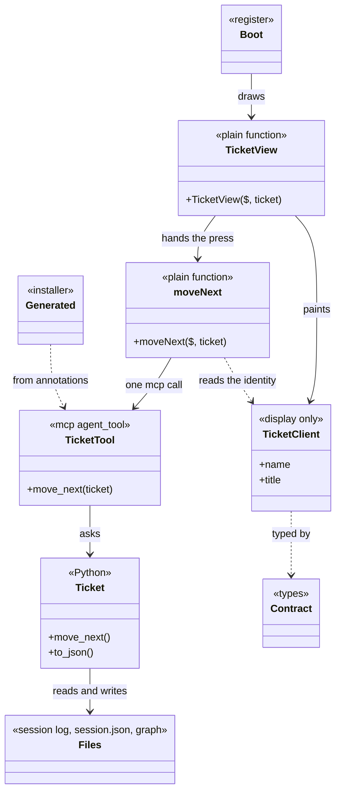
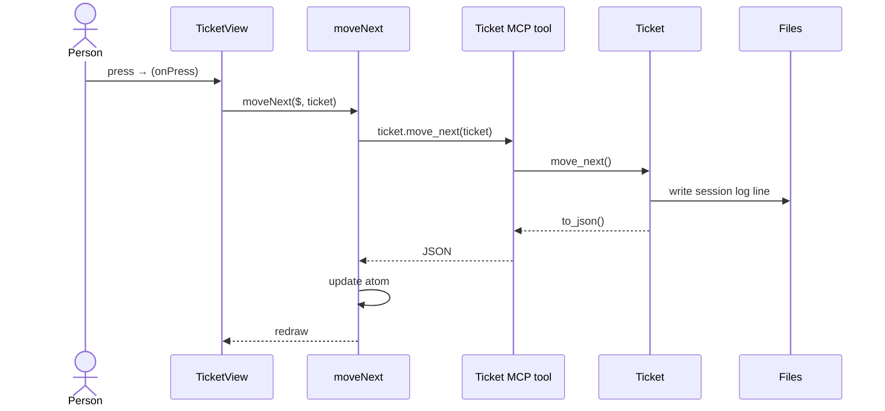

## Overview

Implementation fidelity for a **Claude Code mod that is a view of the CDD domain**. The story map, the module boundaries, and the canvas exist before this tool runs. The rules below are additive on top of what Stories, Clean Engineering, and BDD already enforce.

**The domain is already in Python.** A mod owns none of it. A mod changes what a person sees beside the chat and what the agent is told, and it never changes what is true. The Kanban pane, now retired to `retired/harness/kanban/pane/`, is the worked example throughout this guide, and `tools/chat-mod/` is a small live one. A full screen belongs in a web app with `patterns-lern-domain-driven`, because a pane cannot scroll, lay out, or be tested as a page can. How every door reaches that domain is in `patterns-cdd-web-domain-access`. A mod calls `$.mcp.call` itself, because a hooks module cannot hold a connection, and it takes its types from the language adapter the installer deploys.

**No fidelity progression of its own.** Every run works one domain component through the layers below, Python first.

**The input is any class with MCP operations.** This pattern is for every CDD tool exposed as a Claude Code mod, not only the Kanban. Give it a class and its operations, and it builds the client and the view around that shape.

```python
@agent_toolset
class Report:
    @mcp
    @agent_tool
    def publish(self, report: str, audience: str) -> dict[str, Any]:
        ...
```

| Python | Mod |
|---|---|
| `class Report` | `ReportClient` in `report-client.ts`, `ReportView` in `report-view.tsx` |
| `to_json()` | `ReportData` from the language adapter, and one client property for each field a view paints |
| `@mcp @agent_tool def publish` | `publish($, report, audience)` exported beside the client, the MCP tool `report.publish`, and a control in the view |
| `report: str` | The `ReportClient` the view is painting, which the action reads the identity from |
| `audience: str` | An argument of `publish($, report, audience)`, and an input in the view |

Every domain component has the same pieces, and each piece has one job.

| Layer | File | Role |
|---|---|---|
| Domain | `harness/<domain>/*.py`, `space/<domain>/*.py` | The Python classes. Every rule and decision lives here, including how state is kept. |
| Tool | `harness/<domain>/<object>.py` | The toolset named after the object, so its tools read `{object}.{operation}`. One `@mcp @agent_tool` operation per thing a person or agent does. Parses names, calls the domain, returns `to_json()`. |
| Generated | `.mcp.json`, `.claude/skills/`, `.claude/commands/` | Written by the installer from the tool's annotations. Never edited. |
| Contract | The language adapter, `@cdd/<source folders>/<object>` | `{Object}Data`, the shape `to_json()` returns, generated from Python and imported with `import type`. `pane/types/index.d.ts` declares only `PluginState` for every atom. |
| Client | `pane/hooks/<domain>/<object>-client.ts` | `{Object}Client` and its actions. The class mirrors one Python object's properties for display and holds no `$`. Each action is a plain exported function in the same file, such as `moveNext($, ticket)`, that calls one tool through `$.mcp.call`. |
| View | `pane/hooks/<domain>/<screen>-view.tsx` | `{Screen}View`. A plain function that takes `$` and a client, paints the client, and hands presses to the client's actions. Decides nothing. |
| Surface module | `pane/hooks/<domain>/<part>.tsx` | A `ClientModule`, only for what a Button cannot do, such as a press anywhere on a card. |
| Boot | `pane/hooks/register.tsx` | The events: `session.start`, `ui.render`, `prompt.compose`, `command.run`, and the status line. Connects them to clients and views. |
| Manifest | `pane/.claude-plugin/plugin.json`, `pane/hooks/hooks.json` | Names the mod, its module, and its contract. |

`{domain}` is the component's folder, such as `kanban`. `{Object}` is a Python class inside it, such as `Ticket`. Each object a person acts on has its own toolset and client, so the word `ticket` runs through every layer: `TicketView`, `TicketClient`, `ticket.move_next`, `Ticket`. The component's name appears in folders only.

1. A person presses something in a view.
2. The view calls an action exported beside `{Object}Client`, passing `$` and the client it is painting.
3. The action calls one MCP tool with `$.mcp.call`.
4. The tool loads the domain object and runs the operation of the same name.
5. The domain object changes its own state.
6. The tool returns `to_json()`.
7. The action writes that JSON to its atom, and the write redraws every view that reads it.
8. The next draw builds a new client from the new JSON.

`claude plugin validate` refuses `$` passed to a constructor or a method and accepts it passed to a plain function, local or imported. That is why the class only displays and the actions and views are plain functions: the engine can then see every `$` call a press leads to.

Both diagrams show one example, moving a ticket. Read `Ticket` as your `{Object}`.





---

## Guidance

Enforceable rules live in **§ Shared rules** below. This section explains how they apply; do not treat guidance bullets as a second rule list.

### Same intention as LERN, different pieces

This pattern answers the questions `patterns-lern-domain-driven` answers: where a rule lives, what a view may do, and how one press reaches the domain. The pieces differ because the domain is already built in another language and the front end is a mod, not a browser.

| LERN | This pattern | Why it differs |
|---|---|---|
| `{Domain}` base class in TypeScript | The Python domain class | The domain exists. Copying it into TypeScript would give two places to change every rule. |
| `{Domain}Client extends {Domain}` | `{Object}Client` mirrors what the mod displays, and plain functions beside it act | Two languages cannot share a base class, so `{Object}Data`, generated from the Python, is the agreement between them. `$` cannot be held by an object, so what needs it is a function. |
| `{Domain}Node` | The Python domain class | It already runs on the server side. |
| `{Domain}Repository`, `<aggregate>.json` | **None** | The mod has no store. It asks a tool, and how the domain keeps its state is the domain's decision. |
| Express route file | `{Object}` toolset with `@mcp` | The MCP tool is the route, and its annotations generate the skills and commands. |
| React state holding the client | An atom holding JSON | `$.state` outlives a hot reload, so it holds values, not instances of code that may have changed. |
| `*Node.destination` picks the next page | The domain names the next action | One pane has no paths. The next thing to do is domain data the view paints. |
| Zod `.parse()` on write | The domain class | Python validates. The contract types what comes back. |

### The Kanban, layer by layer

`harness/kanban/` is the worked example, and every new domain component follows it.

| Layer | In the Kanban |
|---|---|
| Domain | `Board`, `Ticket`, `Stage`, `BacklogItem` over `Session`, `Repo`, `Graph` |
| Tool | `ticket.move_next`, `ticket.move_previous`, `ticket.close`, `ticket.archive`, `ticket.new`, `board.show`, `backlog-item.start`, marked directly on `Ticket`, `Board`, and `BacklogItem`. `Ticket` holds a reference to its `Session`, which owns the session's files, so `Ticket.close` calls `Session.close` |
| Generated | The `cdd` entry in `.mcp.json` and the `harness-kanban-*` skills |
| Contract | `TicketData`, `BoardData`, `ColumnData` from the language adapter |
| Client | `TicketClient` and its actions in `pane/hooks/kanban/ticket-client.ts`, `BoardClient` and its actions in `pane/hooks/kanban/board-client.ts` |
| View | `pane/hooks/kanban/board-view.tsx`, `ticket-view.tsx`, and one file for each other screen |
| Surface module | `pane/hooks/kanban/ticket-card.tsx`, `split-grip.tsx` |
| Boot | `register.tsx` |

### One straight line

A person's action reads the same from the button to the domain, so anyone can follow it by searching one word.

| View | Client | MCP tool | Domain |
|---|---|---|---|
| `onPress` | `moveNext($, ticket)` | `ticket.move_next` | `Ticket.move_next()` |
| `onPress` | `archive($, ticket)` | `ticket.archive` | `Ticket.archive()` |

Rules `one-line-from-client-to-domain`, `same-verb-across-layers`, and `preserve-arg-names-across-layers` govern this line. A tool that coordinates more than one domain call has the wrong name or the domain is missing an operation.

### Ticket move next, end to end

One action, through every layer. A person presses the forward arrow on a ticket card.

**View**, `pane/hooks/kanban/ticket-view.tsx`. `TicketView` paints the ticket and hands the press to the action.

```tsx
<Button key={`next-${ticket.name}`} label="→" onPress={() => moveNext($, ticket)} />
```

**Client**, `pane/hooks/kanban/ticket-client.ts`. `TicketClient` carries what the view paints. `moveNext` is a plain function beside it that calls one MCP tool and reads the board again.

```ts
export class TicketClient {
  constructor(private readonly json: TicketData) {}

  get name(): string {
    return this.json.name
  }
}

export async function moveNext($: EngineInterface, ticket: TicketClient): Promise<void> {
  await callTool($, 'ticket.move_next', { ticket: ticket.name })
  await refresh($)
}
```

**MCP tool**, `ticket.move_next`. The marks sit on the domain operation itself. The toolset's `@tool_subject` loader finds the ticket the call names, so the tool takes the loader's arguments and the operation's together, and the MCP server returns the operation's result as `to_json()`.

```python
@agent_toolset
class Ticket:
    @classmethod
    @tool_subject
    def load(cls, ticket: str) -> Ticket:
        ...

    @mcp
    @agent_tool
    @noSessionLog
    def move_next(self) -> Ticket:
        ...
```

**Domain**, the body of that operation in `harness/kanban/ticket.py`. `Ticket` decides what moving next means and records it in the session log.

```python
def move_next(self) -> Ticket:
    """A person's move to the next place on the board, whatever its work."""
    column = self.column
    if not isinstance(column, Stage):
        return self
    if not self.is_done:
        return self._mark_done()
    following = column.next_stage
    return self._enter(following) if following else self.close()
```

The view and the action decide nothing here: whether the ticket closes or moves is answered only by `Ticket`.

### Mirror as needed

`{Object}Client` mirrors the Python class's names, not the whole class. It carries a property only when a view paints it, and an action exists only when a person or the agent can trigger it. Keeping the rest in Python means a new domain rule needs no TypeScript. The test for a line of TypeScript: if it decides something, it belongs in Python. If it shapes something for display, such as a label, a colour, or an age, it belongs on the client.

### State is behind the tool

The mod has no repository and no cache to keep in step. It asks a tool and the domain answers, so how the domain keeps its state never reaches the mod. The atom holds the last JSON a tool returned, so the pane can draw between calls. After an engine event that can change that state, Boot asks again, because the agent's work changes it without the mod knowing.

### Mod mechanics

- A hook is `($, e, next)`. `next(e)` runs the plugins beneath and the engine's own behaviour, so a hook that observes calls it and returns its result.
- `ui.render` receives one component and returns a tree. The elements come from `$.ui.resolve(e)`, because each surface has its own table.
- `atom`, `read`, and `update` hold what a drawing reads. `read` runs while drawing, `update` runs from a handler or another event, and the write redraws what reads it.
- Module variables start over on every reload. `$.state` stays, so a value whose shape changes declares `shape` to carry old values forward.
- Everything outside the module goes through `$`: `$.mcp.call`, `$.ui.status`, `$.ui.toast`, `$.prompt.fill`, `$.command.register`.
- A press inside a region needs a `ClientModule`, because a Button can hold text but no Box. It reports through `surface.post`.
- A slash command runs through `$.command.run({ command, args })`. `$.prompt.submit` refuses text that starts with `/`, and `$.prompt.fill` only fills the box.

### Testing architecture

There are two test sets of the same shape: Python as usual, and `claude plugin test` with stubbed MCP. Both organise their tests by story, with a comment naming the story, such as `// (S) Person --> Move Ticket`. The same behaviour has the same signature in both, and the front end adds tests for layout and interaction.

| What | Where | Runs with |
|---|---|---|
| Domain rules | `harness/<domain>/<domain>_spec.py` | Mamba |
| Tools, through the MCP server | `harness/<domain>/<domain>_tools_spec.py` | Mamba |
| Each tool behaviour under the same signature, plus layout and interaction, through the mounted pane with stubbed MCP | `pane/hooks/register.test.tsx` | `claude plugin test` |
| Module shape and engine refusals | The mod folder | `claude plugin validate` |
| Types | The mod folder | `tsc -p` |

### UX hand-off

The canvas and the story map are designed upstream by `ux` and `stories`. `generate` cites them under **Sources / context**; it does not call them.

---

## Generate

1. Follow **session_guidance**. Start from the Python: name the classes this slice exposes, read their `.context/`, and list their `@mcp @agent_tool` operations, because that list decides the client's operations and the view's controls.
2. Add any missing domain operation and its Mamba spec first. Specs first, small RED cycles.
3. Add the `@mcp @agent_tool` operation on the `{Object}` toolset and its tool spec. Run `python scripts/install.py --ide Claude` so the generated skills, commands, and MCP entry follow.
4. Annotate `to_json()` with a `TypedDict`, mark the class with `@language_adapter(language="typescript")`, and install, so `{Object}Data` follows.
5. Add `{Object}Client` properties and operations for what this slice displays and does, then the view that paints them. Scaffold from `templates/`.
6. Connect events in `register.tsx`.
7. Run `claude plugin validate`, `tsc -p`, and `claude plugin test` on the mod folder, and Mamba on the Python specs.
8. Run validate. If it fails, fix and validate again until it passes.

## Shared rules

```yaml
alwaysApply: false
globs: "**/pane/hooks/**,**/pane/types/**,**/pane/.claude-plugin/**"
```

Whenever you create, alter, or delete a Claude Code mod that views the CDD domain, or the MCP tools it calls. Follow these rules.

If this change will not stay here, follow `practices/clean-engineering/clean-engineering-code.mdc`. The `practices/ddd/ddd-tactics.mdc` rules apply to the Python domain classes.

### Domain and layout

- **`domain-lives-in-python`** — Put every rule and decision in the Python domain class: what a state means, whether an action is allowed, what comes next. A rule written in the mod is lost to every other IDE and to the agent's own tools.
- **`state-lives-behind-the-tool`** — Get every fact from an MCP tool, and keep no store, repository class, or cache in the mod. How the domain keeps its state is the domain's decision, and a second copy in the mod drifts from the real one.
- **`pane-lives-beside-its-domain`** — Keep a mod in a `pane/` folder beside the Python it views, such as `harness/<domain>/pane/`, so a change to the domain and its view is one reviewable change.
- **`domain-folder-in-the-mod`** — Put each domain component's client, views, and surface modules in `pane/hooks/<domain>/`, with one `<object>-client.ts` for each client and kebab-case `<screen>-view.tsx`. One folder per component keeps `register.tsx` from becoming the whole mod.
- **`boot-only-in-register`** — `register.tsx` connects events to clients and views and holds nothing else, so the file a reader opens first shows what the mod reacts to.

### Client and contract

- **`client-mirrors-python-domain`** — Name each client after the Python class it mirrors, such as `TicketClient` for `Ticket`, and its members in camelCase, so one word finds the concept in both languages. A client named after the toolset would gather every object's operations into one class.
- **`client-only-displays`** — `{Object}Client` takes the JSON and nothing else, and exposes properties for display. `claude plugin validate` refuses `$` passed to a constructor or a method, so an object holding `$` never loads.
- **`actions-are-plain-functions`** — Write each action as a plain function exported from the client's file, taking `$` first and the client it acts on next, such as `moveNext($, ticket)`, and write each view as a plain function that takes `$`. Use a `function` declaration, not a `const` holding an arrow function: past an import the engine follows `$` only into a function declaration, and it can then see every `$` call a press leads to.
- **`mirror-only-what-the-mod-uses`** — Add a property only when a view paints it and an action only when a person or the agent triggers it. Everything else stays in Python, because each mirrored member is one more thing to keep in step.
- **`contract-comes-from-the-adapter`** — Import `{Object}Data` from the language adapter with `import type`, and write no copy of it. It is generated from the Python, so a hand-kept type drifts from the real shape. A type import leaves nothing in the module the engine loads.
- **`client-shapes-for-display`** — A client may format: labels, colours, ages, and addresses. If the line changes what is true or what may happen, it belongs in Python.
- **`property-casing-transform`** — `snake_case` in Python and JSON, `camelCase` on the client. The client converts once, when it is built, so views never see two spellings.

### One line from view to domain

- **`one-line-from-client-to-domain`** — One action calls one MCP tool, which calls one domain operation. Work spanning several calls belongs in a domain operation, so the agent's tools and the mod do the same thing.
- **`tool-matches-the-object`** — Name the toolset after the Python object it acts on, so the MCP tool reads `ticket.move_next`. A tool named after the component gathers every object's operations into one toolset, and a reader searching for `ticket` misses it.
- **`same-verb-across-layers`** — Use the same verb and noun from client to domain: `moveNext`, `ticket.move_next`, `Ticket.move_next`. A reader can then follow an action by searching one word.
- **`preserve-arg-names-across-layers`** — Argument names stay the same across layers, with only the casing changing. Renaming at a boundary hides which value is which.
- **`tool-stays-thin`** — A tool operation finds the domain object, calls one operation, and returns `to_json()`. Logic in a tool cannot be reached by anything that calls the domain directly.
- **`mcp-calls-only-on-the-client`** — `$.mcp.call` appears only in a client's file, in one function its actions share. Views and Boot call actions, so there is one place to handle a failed call.
- **`fail-loud-on-mcp`** — When a call fails or the server is missing, show the person what failed and how to fix it. Drawing old state as if it were current misleads them into acting on it.
- **`every-action-reaches-the-agent-the-same-way`** — A person and the agent trigger the same MCP tool, so what the mod shows and what the agent does cannot disagree.

### State and drawing

- **`atoms-hold-json`** — An atom holds the JSON a tool returned, and each draw builds a client from it. `$.state` outlives a reload, so an instance stored there would run old code.
- **`atoms-stay-in-their-file`** — Declare, read, and write an atom in one file, and export a function such as `currentTicket($)` for other files. The engine's scan cannot follow an atom imported from another file, so `claude plugin validate` refuses it.
- **`declare-every-atom`** — Declare each atom in `PluginState` in `pane/types/index.d.ts`, and give it a `shape` when its form changes. `claude plugin validate` holds the module to that contract, and old stored values reach new code.
- **`no-state-in-module-variables`** — Keep what a drawing reads in an atom. Module variables start over on every reload, so the pane would lose its place.
- **`refresh-on-engine-events`** — Boot calls the tool again on each engine event that can change what the mod shows, such as a prompt or a tool call. The agent changes state without telling the mod, so the mod must ask.
- **`views-render-only`** — A view paints a client and calls its actions. It holds no `$.mcp.call`, no rule, and no atom write.
- **`size-to-the-pane`** — Size a tree to `e.props.bodyColumns`, which excludes what the engine draws over, so nothing is cut off.
- **`key-every-listed-button`** — Give every Button in a list its own `key`. A Button's key defaults to its label, and a surface finds a Button again by that key after a redraw.
- **`surface-module-for-region-press`** — Use a `ClientModule` only for what a Button cannot do. Its `surface.post` reports to the pane, and the pane calls the action, so the line stays straight.
- **`size-a-client-exactly`** — Give a `Client` an explicit `height` and truncate its lines. A region left to measure wrapped text is laid out at the wrong height, draws over what sits below it, and those controls stop answering presses. Keep Buttons in the pane's own tree, where `claude plugin test` can press them.
- **`consistent-view-naming`** — View functions end in `View`, and screen filenames stay kebab-case.

### Engine hooks

- **`hooks-pass-through`** — A hook that only observes calls `next(e)` and returns its result, so the engine and the plugins beneath still run.
- **`agent-context-comes-from-the-client`** — `prompt.compose`, the status line, and the band read the same client as the views, so a person and the agent are told the same thing.

### Testing

- **`identical-signatures-across-languages`** — Give each tool behaviour a front-end test with the same signature as its Mamba spec, so `should show the ticket in the next stage` is written once in each language. A signature on one side only shows a behaviour that is untested on the other.
- **`spec-the-tool-boundary`** — Each MCP operation has a tool spec that asserts the JSON the contract promises, because that is what keeps two languages in step.
- **`prove-it-on-the-real-surface`** — Give what a person sees a third layer, a `*_surface_heavy_spec.py` beside the domain, with the same signatures as `claude plugin test` and a different implementation: it runs the real mod against the real MCP server and measures where things landed, through UI Automation on the desktop and a real session on the terminal. The test kit stands for the engine and stubs the server, so it cannot see a pane that shrank, a control past a card's edge, or a stubbed answer that no longer matches Python. Run it only on a surface that has reloaded the current mod and server, because an open pane keeps drawing the code it started with.
- **`test-the-mod-through-the-engine`** — Test each signature through the mounted pane with `claude plugin test`, which runs the hooks and mounts the pane with stubbed MCP: press what a person presses and assert what they see or which tool was called. Seed what an earlier version stored, so a reload meets real old values. Calling client and view objects directly would pass while the pane itself is broken.
