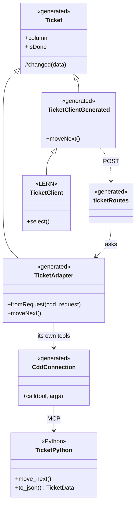
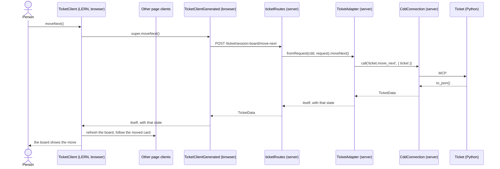

## Overview

How anything outside Python reaches the **CDD domain**. The domain, its rules, and its state stay in Python. Skills, actions, and commands reach it through MCP tools. Code in any other language reaches those same tools through a **language adapter** for that language, which the installer deploys beside the skills and MCP operations. Every language follows the same pattern, and TypeScript is the first implementation, so the examples below are TypeScript.

**Every MCP call is made on the server.** The cdd server is a local program the application's server starts and talks to over its standard input and output. A browser cannot start it or reach it, and exposing it to the page would bypass the application server's guard on who may act. So the browser asks the application's server, and the server calls MCP.

**The language adapter is a straight conversion of the Python, and the installer writes all of it.** Everything it needs is already in the Python: the tool names, their arguments and types, what each returns, the shape `to_json()` returns, and which field names the object. Because the browser's path to the server follows one fixed rule, the installer writes both ends of it, so they match by construction:

| Generated | Where it runs | What it is |
|---|---|---|
| `{Object}` | Browser and server | The shared base: the object's state, its `camelCase` getters, `changed(data)`, which takes on new state, and `onChanged(listener)`, which tells a view when it did. It makes no call. **Nothing uses it directly**; code always works with one of its subtypes. |
| `{Object}Adapter extends {Object}` | Server | Each operation calls its MCP tool and takes on the state Python returns. |
| `{Object}ClientGenerated extends {Object}` | Browser | Each operation posts to its route and takes on the state the server returns. |
| `{object}Routes` | Server | One route for each tool. Each reads the request against the tool's published schema and calls `{Object}Adapter`. |
| `CddConnection` | Server | One per install. Starts one cdd server and carries calls to it. It knows no tool by name. |
| `use{Object}(client)` | Browser | A React hook that re-renders a view whenever the client takes on new state. |
| `FileListViewGenerated`, `SourceViewGenerated` | Browser | Shared default views over the session's file manager: a folder's files to pick from, and a file's text in Monaco with a line or range marked. Any field Python marks as a file opens in `SourceViewGenerated`. |
| `{Object}ViewGenerated`, `{Object}NewViewGenerated` | Browser | Starting-point React views: the object with each field editable where a domain operation changes it and read-only elsewhere, its other operations as buttons and forms, and a form for each operation that creates one. **Never deployed as they are**; an application composes them, or copies one and changes it. |

**What the application's pattern adds.** LERN mounts `{object}Routes` on its server, subclasses `{Object}ClientGenerated` for what only the page knows, such as selecting a card or showing a toast, and builds its pages from the generated views. That subclass is LERN's `{Domain}Client`; the pages, layout, and navigation are LERN's own. A Claude Code mod reaches the tools through `$.mcp.call`, as `patterns-cdd-claude-mod` describes. Nothing in the application calls a tool, parses a request for one, or writes a path to one.

**No god connector.** Each domain object has its own classes that know its own tools. `TicketAdapter` calls `ticket.move_next`, and `BoardAdapter` calls `board.show`. One connection underneath carries the calls and knows no tool by name.

**Reach the end-user API, not the framework.** Practices, patterns, actions, and `space` are the CDD domain an application reaches. `harness/` is the framework that installs and serves them, so an application does not call into it. The graph is reached through the practices that read it, such as validate with `graph`; expose a graph tool directly only when an application's generation needs it and no practice gives it.

**No fidelity progression of its own.** Every run works one domain object through the layers below, Python first.

| Layer | File | Role |
|---|---|---|
| Domain | `cdd_guidance/practices/<practice>/*.py`, `cdd_guidance/patterns/<pattern>/*.py`, `cdd_guidance/actions/<action>/*.py`, `space/<domain>/*.py` | The Python classes. Every rule, decision, and piece of state lives here. |
| Tool | The same file, marked `@mcp @agent_tool` | One operation for each thing a person or agent does. The tool reads `{object}.{operation}`. |
| Contract | `{Object}Data`, a `TypedDict` that `to_json()` is annotated with | The only agreement between the languages. The language adapter is written from it. |
| Mark | `@language_adapter(language="typescript", identity="name")` on the class | Opts the toolset in to the language adapter for that language. `identity` names the field of `{Object}Data` that holds the object's name, so a browser object knows which object its routes act on. |
| Language adapter | `<install path>/language-adapters/<language>/<source folders>/<object>.<ext>` | Generated: `{Object}Data`, `{Object}`, `{Object}Adapter`, `{Object}ClientGenerated`, `{object}Routes`, `use{Object}`, and the starting-point views. |
| Connection | `<install path>/language-adapters/<language>/cdd-connection.<ext>` | Generated: `CddConnection`, once per install. |





---

## Guidance

Enforceable rules live in **§ Shared rules** below. This section explains how they apply; do not treat guidance bullets as a second rule list.

### Every door reaches the same tool

A person typing a slash command, an agent calling a tool, and a person pressing a button in a web app all reach one MCP tool, and the tool calls one domain operation. Because they share that tool, what the board shows and what the agent does cannot disagree.

| Door | Reaches the tool through |
|---|---|
| Skill, action, or command | The agent calls the MCP tool |
| Claude Code mod | `$.mcp.call`, typed by the language adapter, as `patterns-cdd-claude-mod` describes |
| Web page | `{Object}ClientGenerated`, then `{object}Routes`, then `{Object}Adapter` |
| Server code | `{Object}Adapter` |

### One straight line

An operation reads the same from the page to the domain, so anyone can follow it by searching one word.

| Browser | Route | Server | Tool | Domain |
|---|---|---|---|---|
| `TicketClientGenerated.moveNext()` | `POST /ticket/:ticket/move-next` | `TicketAdapter.moveNext()` | `ticket.move_next` | `Ticket.move_next()` |
| `TicketClientGenerated.enablePractice(practice, isEnabled)` | `POST /ticket/:ticket/enable-practice` | `TicketAdapter.enablePractice(practice, isEnabled)` | `ticket.enable_practice` | `Ticket.enable_practice(practice, is_enabled)` |

The route is the tool's object, then the object's identity when the tool loads one, then the operation in kebab case. Every route is a `POST` with the operation's own arguments in the body, so both ends follow from the tool's name alone.

### The language adapter is a deployment target

The installer treats a language adapter as one more channel, beside skills, commands, rules, MCP, and hooks. It walks the same toolsets, reads the same marks, tracks what it writes so `clean` removes it, and reports it in `diagnostics.json`. Like the rest of the install it is generated, never edited, and not committed, so run the installer on a fresh clone before building. Each language gets its own folder under `language-adapters/`; a new language adds a writer for that folder and changes nothing in the Python domain or its tools. The TypeScript adapter below is the first.

```python
@language_adapter(language="typescript", identity="name")
@agent_toolset
class Ticket(Card):
    def to_json(self) -> TicketData: ...
```

```
.claude/language-adapters/typescript/
├── cdd-connection.ts            CddConnection, using only Node's own modules
├── cdd-shared.ts                what every object shares and a browser can load: reading a request, the page's API, the errors
├── cdd-views.tsx                the inputs, buttons, and forms every generated view draws
├── harness/kanban/
│   ├── ticket.ts                every generated class: TicketData, Ticket, TicketClientGenerated, TicketAdapter, ticketRoutes
│   ├── ticket-views.tsx         useTicket, TicketViewGenerated, TicketNewViewGenerated
│   ├── board.ts
│   └── board-views.tsx
└── space/session/...
```

The folders mirror the toolset's source. Only marked toolsets are written, so catalog pages, rules, and guidance prose never appear here. **Mark a toolset when an application needs its results as data.** A toolset that returns prompt text for an agent to follow, as the practices and actions do, gains little from a typed adapter, so it stays unmarked.

Import it through the `@cdd` path alias, which points at the install. The install sits outside every application's packages, so the adapter imports no package: the connection speaks MCP with Node's own modules, the routes are plain data any server framework can mount, and the client posts through whatever `CddApi` the page hands it. Every generated class of an object sits in one `<object>.ts`. The browser and the server both import it, and it loads nothing of Node, because it takes the connection only as a type; only the server constructs a `CddConnection` and an `{Object}Adapter`. The views sit in their own `<object>-views.tsx`, because they need JSX and React, which the server has no reason to load.

```ts
export class Ticket {
  #state: TicketData | null

  constructor(state: TicketData | null) {
    this.#state = state
  }

  toJSON(): TicketData {
    return this.#read()
  }

  get isDone(): boolean {
    return this.#read().is_done
  }

  protected changed(state: TicketData): this {
    this.#state = state
    return this
  }

  // A server adapter is built from the name a request carries, before Python has sent its state.
  #read(): TicketData {
    if (!this.#state) throw new CddNotReadError('ticket')
    return this.#state
  }
}

export class TicketAdapter extends Ticket {
  constructor(protected readonly cdd: CddConnection, protected readonly ticket: string, state: TicketData | null = null) {
    super(state)
  }

  static fromRequest(cdd: CddConnection, request: CddRequest): TicketAdapter { ... }

  async moveTo(stage: string, done?: boolean): Promise<this> {
    return this.changed(await this.cdd.call<TicketData>('ticket.move_to', { ticket: this.ticket, stage, done }))
  }
}

export class TicketClientGenerated extends Ticket {
  constructor(protected readonly api: CddApi, state: TicketData | null = null, protected readonly ticket: string = state?.name ?? '') {
    super(state)
  }

  static named(api: CddApi, ticket: string): TicketClientGenerated {
    return new TicketClientGenerated(api, null, ticket)
  }

  async moveTo(stage: string, done?: boolean): Promise<this | null> {
    const state = await this.api.post<TicketData>(`/ticket/${encodeURIComponent(this.ticket)}/move-to`, { stage, done })
    return state ? this.changed(state) : null
  }
}

export const ticketRoutes: CddRoute[] = [
  { path: '/ticket/:ticket/move-to', run: (cdd, request) => { ... TicketAdapter.fromRequest(cdd, request).moveTo(sent.stage, sent.done) } },
]
```

- An operation whose tool returns the object's own data takes on that state and returns the object. Any other result, such as another object's data or a choice of objects, is returned as Python sent it.
- A Python `@classmethod` operation becomes a `static` operation that takes the connection or the API and returns the new object's data. The application builds the subtype it needs from that data.
- A route reads the operation's arguments from the body, checked against the tool's published schema, and raises `CddRequestError` when one is missing or the wrong type. The schema already says what each argument is, so the application writes no parsing.
- `CddApi.post` answers `null` once the page has shown the person a failure, so a browser operation then keeps its state and returns `null`, and the page stops there.
- Page code that knows only a name builds `{Object}ClientGenerated.named(api, name)` and acts on that object before it has read it.
- An object without `identity`, such as the one board, has routes with no name in them.

### Generated views

The Python says enough to draw a working view of each object, so the installer writes one as a starting point. It is never a finished page: an application composes it into its own pages, or copies it into its own source and changes it completely. Pages, layout, navigation, and anything bespoke, such as the board's tiles and drag, are always the application's own.

**A field is editable where a domain operation changes it.** The view never writes a field; every edit is an operation, because Python decides what a change means and whether it is allowed. An operation that loads the object, answers with the object's own data, and takes an argument with the same name as a field, such as `update_text(text)`, makes that field an input, and saving calls the operation; any other argument it needs must itself be a field, which is sent as it stands. Where the names differ, `@edits("title")` from `harness.installation.destination`, placed directly on an operation with one argument such as `rename(new_title)`, names the field that argument changes. An operation that answers with something else, such as `BacklogItem.start(scope, path)` answering with a ticket, never edits a field, even where an argument shares a field's name. A field no operation changes, such as `is_done`, `progress`, or `allowed_actions`, is shown read-only, because only Python decides it.

**The input follows the published type.** A string is a text field, a boolean a checkbox, a number a number field, and a list of strings a multi-select. An argument with a default is optional on the form. A nested field, such as a column's `wip_limit` inside the board, is reached through its operation's form rather than inline, unless `@edits` names it.

**Every other operation is a button or a form.** An operation with no arguments of its own, such as `moveNext`, is a button; one with arguments, such as `moveTo(stage, done)`, is a small form built the same way. An operation that answers with something other than the object, such as `report(fidelity)`, shows its answer beneath the form. An operation the view already uses to edit a field is not drawn again as a form. Each calls the client the view was given, so a page that hands in its own subclass, such as LERN's `TicketClient`, gets its page work, such as refreshing the board, on every action.

**An operation that creates the object gives a new-object form.** Each class operation that answers with the object's own data, such as `Ticket.new(title, scope, parent, path)` or `BacklogItem.add(title, text)`, becomes a form in `{Object}NewViewGenerated`, which calls it with the API it is given and hands the new object's data to `onCreated`.

**`use{Object}(client)` keeps a view current.** The client takes on new state through `changed`, which tells its `onChanged` listeners; the hook subscribes and re-renders. Any view holding a client, generated or the application's own, uses it instead of keeping a second copy of the object's state.

```tsx
export function TicketViewGenerated({ client, fields, operations }: TicketViewProps) {
  const ticket = useTicket(client)
  return (
    <section>
      {fields?.title?.(ticket) ?? <TextField label="Title" value={ticket.title} onSave={title => client.setTitle(title)} />}
      {fields?.column?.(ticket) ?? <ReadOnlyField label="Column" value={ticket.column} />}
      {operations?.moveNext?.(ticket) ?? <OperationButton label="Move next" onRun={() => client.moveNext()} />}
    </section>
  )
}
```

**An application changes a view by composing it, or by copying it.** React components are composed rather than subclassed, so each generated view takes props that replace any one field's rendering or any one operation's form, and a page wraps the view in its own layout. When that is not enough, the application copies the view into its own source and changes it freely. A copied view still calls the generated client, so its edits still go through domain operations; what a copy cannot do is make a field editable that no operation changes.

**React comes from the application.** The install holds no packages, so the views import `react` through the application's own copy: `react` and `react/jsx-runtime` in the application's TypeScript `paths`, pointing at its `@types/react`, and `react` in its bundler's aliases, beside `@cdd`. Each views file starts with `/** @jsxRuntime automatic @jsxImportSource react */`, because the install has no TypeScript settings of its own for the bundler to read. The views draw plain, unstyled elements with stable class names, such as `cdd-field` and `cdd-operation`, so the application's stylesheet gives them their look. The shared inputs, buttons, and forms they draw live in `cdd-views.tsx`.

### Files: the session's file manager

Every application ends up showing files: a ticket's outputs, a report's failing line, the source behind a graph node. The page cannot read the disk, so a tool reads it, and one shared tool does it for every application rather than a read operation on each object.

**The file manager is `FileManager`, in `tools/file_manager/`, and the session owns it.** The session holds it in memory; nothing about it is written to the session's files, because it keeps no state of its own beyond the roots it reads. Its loader takes the current session's file manager, so a page names no root and no session to reach it, the same way it reaches the one board. Reading and listing files needs no git, which is why it belongs to the session and not to the repository.

**It reads under the session's roots, and nowhere else.** The session's roots are its workpath: the folder each practice works in, as the session's `session.json` records it, or the practice's default folder when it records none. They are not the session's own folder under `.sessions/`. A page names a path from the workpath, so a root outside it reads back as `../reports/...`.

| Operation | Answers with |
|---|---|
| `list(folder)` | `FolderData`: the folder's entries, each a name, its path, whether it is a folder, and its size |
| `read(path)` | `FileTextData`: the file's path and text |

Both refuse a path outside every root with `PathOutsideRootsError`, because the page is open to whatever a request names, and so an application never loads files from outside the session's roots. `FileManager` is marked for TypeScript, so the installer generates its adapter, its routes, and `FileManagerClientGenerated` like any other object's.

**Two shared views come with it.** `FileListViewGenerated` lists a folder and opens what a person picks. `SourceViewGenerated` shows a file's text in Monaco, read-only, scrolled to a line or with a range of lines marked. As with every generated view, an application uses them, composes them, or ignores them; none writes its own file viewer.

**Python marks which fields are files.** A field typed `Annotated[str, SourceFile]` in a `TypedDict` holds a path from the workpath, inside the session's roots. Where the same data has `line`, or `start_line` and `end_line`, the view takes them as the line or range to mark. A generated view draws a marked field as a link that opens `SourceViewGenerated` at that file, so a report's violation, a graph node's source, and a ticket's output all open the same way.

```python
class SourceLineData(TypedDict):
    path: Annotated[str, SourceFile]
    line: int | None
```

**Monaco comes from the application**, as React does: `@monaco-editor/react` in the application's TypeScript `paths` and its bundler's aliases. Only a views file that draws a file field, and the shared source view itself, import it, so an application with no file fields never needs Monaco.

### Python states the contract

`{Object}Data` is a `TypedDict` the domain class annotates `to_json()` with, so the shape is written once, in Python, and every other language follows. A plain `dict[str, Any]` generates `Record<string, unknown>`, which the compiler cannot check. `NotRequired` becomes an optional field, and `str | None` a nullable one. Fields keep Python's `snake_case` in `{Object}Data`, because it states exactly what `to_json()` returns and some keys are data, such as a fidelity named `story_map`. The getters, operation names, and arguments are `camelCase`, and the adapters send arguments under their Python names.

### State stays behind the tool

An application keeps no copy of what the domain owns. There is no repository, no store, and no cache for a CDD object, because a second copy drifts from the first and the agent changes state without telling the application. An adapter holds only the state its last call returned; to stay current, call again.

**lowdb is for state CDD does not own.** A web app built in LERN still uses lowdb for what belongs to that app alone, such as a person's saved layout. For an aggregate backed by CDD, `{Object}Adapter` takes the repository's place on the server.

### Long calls and progress

**Every call finishes within ten minutes.** `CddConnection` stops waiting after ten minutes and raises `CddToolError`. An operation that needs longer is a defect in that operation, to fix in Python by doing less per call, not by raising the limit for one application.

**An operation that takes more than a moment says what it is doing.** Loading a working copy into the graph can take minutes, and a person watching a page with no news cannot tell work from a hang. A Python operation reports its steps as it goes, and they reach the page as MCP progress notifications:

1. `CddConnection` asks for progress on every tool call, under that call's own id, and keeps the newest step each running call has reported.
2. The Python operation calls `report_progress(message)`, from `harness.agent_tools.progress`, at each step; the graph's own `report_progress` does so for every practice, file, and rule it loads. The MCP server turns each report into a progress notification for that call, and a report made outside a tool call goes nowhere.
3. `cddProgressRoutes`, in `cdd-shared.ts`, answers `/cdd/progress` with those steps; the application mounts it beside its objects' routes. `ProgressViewGenerated` reads it while it is shown and draws the newest step of each running call, and nothing once they have finished.

So no application keeps its own progress channel beside the tool.

### When a call fails

The MCP server answers a failed operation with plain text, such as `TicketNotFoundError: no ticket x`, and it does not always set `isError`. Every successful operation returns JSON, so `CddConnection` treats text that is not JSON as a failure and raises `CddToolError` with that text. When the server cannot start or stops, it raises `CddNotConnectedError`. The application's pattern decides how each shows to the person.

### Testing

The Python domain keeps its own Mamba specs, and `{object}.{operation}` keeps its tool spec. An application's tests that call `{Object}Adapter` run it against the real cdd server on a throwaway project, because a stubbed tool would still pass after the Python changed. A behavior both languages state keeps the same `should` sentence, so a sentence on one side only shows what is untested on the other. The generated routes and `{Object}ClientGenerated` are tested once, in the installer's specs, so an application tests its own subclass and not the paths between them.

---

## Generate

1. Follow **session_guidance**. Start from the Python: name the classes this slice exposes, read their `.context/`, and list their `@mcp @agent_tool` operations.
2. Add any missing domain operation and its Mamba spec first. Annotate `to_json()` and each operation's result with a `TypedDict`, and mark the class with `@language_adapter(language=..., identity=...)`: the application's language, such as `"typescript"`, and the field of `{Object}Data` that names the object.
3. Run `python scripts/install.py --ide Claude`. The language adapter follows, with the skills, commands, and MCP entry.
4. Point the `@cdd/*` path alias at `<install path>/language-adapters/typescript/`, and alias `react` to the application's own copy so the generated views resolve it.
5. Construct one `CddConnection` on the application's server and mount every `{object}Routes` on it. Subclass `{Object}ClientGenerated` for what only the page knows, and build pages by composing the generated views, or copying one and changing it. The application's pattern says where each lives.
6. Run the type-check, the tests, and validate. If validate fails, fix and validate again until it passes.

## Shared rules

```yaml
alwaysApply: false
globs: "**/*-routes.ts,**/*-node.ts,**/*-client.tsx,**/*-view.tsx,**/*-tools.ts,**/*-adapter.ts,**/cdd-connection*.ts"
```

Whenever you create, alter, or delete code outside Python that reaches the CDD domain, or the MCP tools it calls. Follow these rules.

If this change will not stay here, follow `practices/clean-engineering/clean-engineering-code.mdc`. The `practices/ddd/ddd-tactics.mdc` rules apply to the Python domain classes.

### Domain and state

- **`domain-lives-in-python`** — Put every rule and decision in the Python domain class: what a state means, whether an action is allowed, what comes next. A rule written in another language is lost to the agent's tools and to every other door.
- **`state-lives-behind-the-tool`** — Get every fact about a CDD object from its adapter, and keep no repository, store, or cache of it beside the state the adapter's last call returned. The agent changes that state without telling the application, so a copy goes stale.

### One object, one set of generated classes

- **`one-class-per-object`** — Each domain object has its own generated `{Object}Adapter` and `{Object}ClientGenerated` that call only that object's tools. Code that calls a tool by name, or posts to a tool's route by hand, has skipped the object's typed operation and hides which object owns it.
- **`adapter-is-generated`** — The installer writes `CddConnection`, `{Object}`, `{Object}Adapter`, `{Object}ClientGenerated`, and `{object}Routes`, and nobody edits them or writes one by hand. Subclass `{Object}ClientGenerated` only for what the page alone knows, never to add a call, a route, or parsing. A hand-kept class drifts from Python, and the compiler then checks the wrong thing. The generated views are the exception: they only present what the client already does, so an application may copy one and change it.
- **`views-are-a-starting-point`** — Compose a generated view into the application's own page, or copy it into the application's source and change it; never ship one as the page itself. It knows the object's fields and operations but nothing about the page it sits on.
- **`edits-go-through-operations`** — A view changes a field only by calling the domain operation that changes it, and shows a field no operation changes as read-only. A view that writes a field directly decides in the browser what only Python may decide.
- **`views-share-the-client-state`** — A view reads its object through `use{Object}(client)` and keeps no copy of the object's state. A second copy shows the old state after an operation returns.
- **`mark-toolsets-that-return-data`** — Mark a toolset with `@language_adapter` when an application needs its results as data, and name its `identity` when a tool loads one object. Marking one that returns prompt text adds an adapter nobody can type.

### One line from adapter to domain

- **`one-line-to-the-domain`** — One adapter operation reaches one MCP tool, which calls one domain operation. Work spanning several calls belongs in a domain operation, so an agent and a person get the same result.
- **`tool-matches-the-object`** — Name the toolset after the Python object it acts on, so the tool reads `ticket.move_next`. A tool named after the component gathers every object's operations into one class.
- **`same-verb-across-layers`** — Use the same verb and noun from page to domain: `moveNext`, `/ticket/:ticket/move-next`, `ticket.move_next`, `Ticket.move_next`. A reader can then follow an action by searching one word.
- **`tool-stays-thin`** — A tool finds the domain object, calls one operation, and returns `to_json()`. Logic in a tool cannot be reached by anything that calls the domain directly.

### Contract and failure

- **`annotate-what-typescript-reads`** — Annotate `to_json()` and each MCP operation on a marked toolset with a `TypedDict`. A plain `dict[str, Any]` generates an open record, which the compiler cannot check.
- **`calls-finish-in-ten-minutes`** — Keep every operation within the ten-minute limit, and fix one that needs longer instead of raising the limit. A page that waits longer than that looks broken, and a raised limit hides the slow operation.
- **`report-progress-on-long-calls`** — An operation that takes more than a few seconds calls `report_progress` at each step, and the page shows them with `ProgressViewGenerated`. A page with no news looks the same as one that has stopped.
- **`read-files-through-the-file-manager`** — Show a file through the session's `FileManager` and its source view, and mark a file field `Annotated[str, SourceFile]`. A read operation or a file viewer written for one object is a second copy of what every application shares.
- **`fail-loud-on-mcp`** — When a call fails or the server is missing, show the person what failed and how to fix it. Drawing old state as if it were current misleads them into acting on it.

### Testing

- **`test-the-adapter-against-real-cdd`** — Tests that call `{Object}Adapter` run against a real cdd server on a throwaway project. A stubbed tool would pass after the Python changed.
- **`act-on-a-throwaway-project`** — Any test that moves, closes, or commits runs on a throwaway project with no real remote, because these tools really commit and push.
