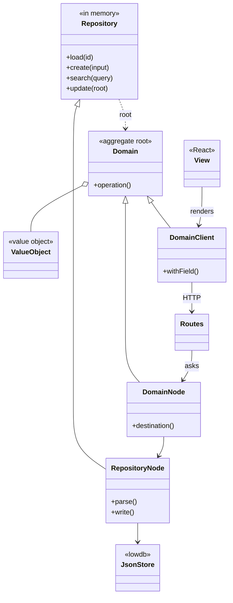
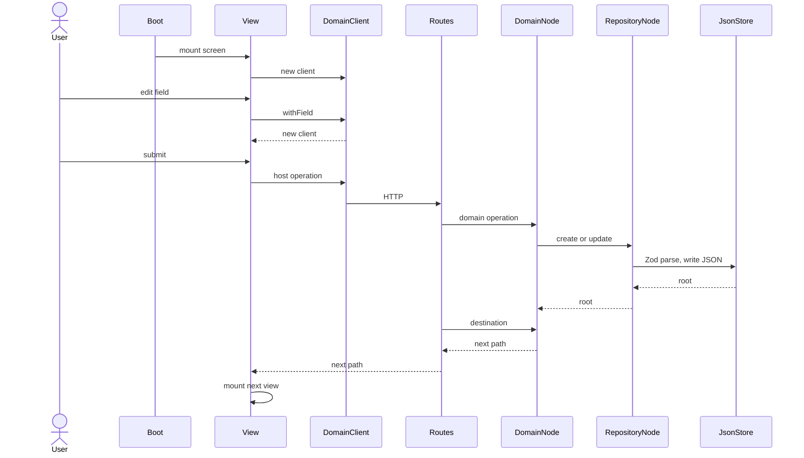

## Overview

Implementation fidelity for a **domain-module-organized LERN stack** ([lowdb](https://github.com/typicode/lowdb)
JSON files / Express / React / Node, TypeScript everywhere) on an already-designed
vertical slice — story map, module boundaries, and screens all exist before this
tool runs. `generate` calls `self._stories()` at `acceptance_tests` /
`typescript` — specs first, then Stories' own `ce()` wires matching
production TypeScript. The rules below are additive on top of what Stories
and CleanEngineering already enforce, not a restatement of them.

**No fidelity progression of its own.** Every run pins `stories` at
`acceptance_tests` with `format="typescript"`; production code arrives via
Stories' `ce()` companion at `code` / `typescript`.

One aggregate. `{Domain}Client` and `{Domain}Node` extend `{Domain}`. The view paints the client. The route asks the node. `{Domain}Repository` is in-memory. `{Domain}RepositoryNode` extends it, runs Zod `.parse()`, and writes `<aggregate>.json`.

| Layer | File | Role |
|---|---|---|
| Boot | `packages/<epicSlug>/app.ts`, `serve.ts`, `main.tsx` | Start Express and Vite. Mount the first view. |
| View | `src/…/<aggregate>/<screen-slug>.tsx` | Hold the client in React state. Paint fields and actions. |
| Client | `<aggregate>-client.tsx` | `{Domain}Client`. Field changes return a new instance. Call the route. |
| Routes | `<aggregate>-routes.ts` | Parse the request. Call the node. Return `destination`. |
| Node | `<aggregate>-node.ts` | `{Domain}Node` maps the step to a path. `{Domain}RepositoryNode` runs Zod `.parse()` and writes `<aggregate>.json`. |
| Domain | `<aggregate>.ts` | `{Domain}`, `{SubDomain}`, in-memory `{Domain}Repository`. Framework-free. |
| Store | `<aggregate>.json` | One lowdb file. `{Domain}RepositoryNode` is the only writer. |

1. Boot mounts the view for the current path.
2. The view constructs `{Domain}Client` and paints its fields.
3. A field edit replaces React state with a new client.
4. Submit calls the aggregate route.
5. The route builds `{Domain}Node` and runs the domain operation.
6. The node calls `{Domain}RepositoryNode` (`load`, `create`, `search`, or `update`).
7. `{Domain}RepositoryNode` runs Zod `.parse()` and writes `<aggregate>.json`. `{Domain}Repository` stays in memory.
8. The route asks `{Domain}Node.destination` and returns that path.
9. The next view in the aggregate folder mounts.





---

## Guidance

Enforceable rules live in **§ Shared rules** below. This section explains how
they apply; do not treat guidance bullets as a second rule list.

### Domain-driven design (reference)

This architecture **is** DDD tactics on JSON-file persistence. Stereotypes,
invariants, and repository seams come from
[`practices/ddd/ddd.md`](../../practices/ddd/ddd.md) **model** and **tactics**. Honour
those definitions; this spec only says how they land on lowdb.

| Stereotype | Meaning (from `ddd.md`) |
|---|---|
| **Entity** | An object defined by its unique identity rather than its attributes, maintaining continuity across state changes over time. |
| **Aggregate** | A cluster of associated domain objects (entities and value objects) grouped together to maintain consistent business rules as a single unit. |
| **Aggregate Root** | The main entity inside an aggregate that acts as the sole gateway, controlling all external access and enforcing consistency rules for the entire cluster. |
| **Value Object** | Fully described by values — interchangeable, replaceable, immutable. Prefer VO unless tracked identity is required. |
| **Repository** | Hides storage so the business loads, saves, and queries **entire aggregates** as if they lived in a memory collection. Collection-style seam: the business finds, stores, and retires this aggregate through the root. |

Each **domain module** is one aggregate. `{Domain}Repository` is the in-memory
collection: `load`, `create`, `search`, `update` on the **aggregate root**.
`{Domain}RepositoryNode` extends that collection and is the only class that
opens this aggregate's JSON file. `{SubDomain}` objects travel inside the
root's snapshot.

---

### Layout: bounded context, aggregate, epic shell

Domain tiers, views, the node file, the client file, and one route file live
under `src/<boundedContext>/<aggregate>/`. Epic packages under
`packages/<epicSlug>/` hold process boot and what is common across the epic
(top-level router, shell layout, shared assets, epic-wide logic) — they import
the aggregate through `@src`. Screens live in the domain they serve.

```
src/
  <boundedContext>/
    <aggregate>/
      <aggregate>.ts                    ← {Domain}, {SubDomain}, in-memory {Domain}Repository
      <aggregate>-node.ts               ← {Domain}Node; {Domain}RepositoryNode writes lowdb
      <aggregate>-client.tsx            ← browser client; the view renders this
      <screen-slug>.tsx                 ← views in this folder
      <aggregate>-routes.ts             ← one route file for this aggregate
      <aggregate>.json                  ← lowdb store for this aggregate

packages/<epicSlug>/                    ← epic package — boot and epic-wide common pieces
  app.ts / serve.ts / main.tsx          ← Express + Vite process boot
  <epicSlug>-router.tsx, shell, assets  ← common to every screen in the epic
  onboarding-frame.tsx                  ← composes the step screens for the flow's owner
  package.json / index.html / vite.config.ts
```

A view, the client file, and the node file are siblings in the aggregate
folder. The view renders the client. The node selects the view. The aggregate
has one route file. Views are domain files, the same as the client and the node.

Rule `screens-live-in-their-domain` governs the split. Keep each screen in the
aggregate folder of the domain it serves. Do **not** put `<aggregate>.ts`,
`<aggregate>-node.ts`, `<aggregate>-client.tsx`, a step screen, or an aggregate
route file under the epic package. The epic package may hold the top-level
router, the frame that composes the step screens, the shell layout, shared
assets, and epic-wide logic.

Rule `domain-core-file-matches-folder-slug` governs filenames: kebab-case core
files (`<aggregate>/<aggregate>.ts`), PascalCase exported types (`{Domain}`).

---

### Persistence: one lowdb JSON store per aggregate

[lowdb](https://github.com/typicode/lowdb) is the adapter (`JSONFilePreset` /
`JSONFile` from `lowdb/node` in production; `Memory` from `lowdb` in tests).
Each aggregate's JSON file sits beside its domain module in `src/<domain-slug>/`.

```
src/<domain-slug>/<domain-slug>.json
{
  "<collection-key>": [                 ← serialized aggregate roots for this aggregate
    { "id": "…", … }
  ]
}
```

Rules `one-json-store-per-aggregate` and `repository-owns-aggregate-lifecycle`
govern this layer. Repositories never open another aggregate's JSON file.
Required operations, named in ubiquitous language:

| Operation | Returns | Role |
|---|---|---|
| `load(id)` | aggregate root or `null` | find by identity already in hand |
| `create(input)` | new aggregate root | birth |
| `search(query?)` | aggregate roots | find by attributes / example |
| `update(root)` | updated aggregate root | persist a mutation already applied on the root |

`{Domain}Repository` on `<aggregate>.ts` is in-memory only: `load`, `create`,
`search`, `update`. `{Domain}RepositoryNode` on `<aggregate>-node.ts` extends
it, runs Zod `.parse()`, and writes `<aggregate>.json`. Routes and views never
call `JSONFilePreset` / `db.data` themselves.

Cross-aggregate consistency is **outside** a single JSON file. Choose one
coordination style **when generating stories** (see `ask-cross-aggregate-sync`
in § Shared rules) — then keep that choice for the slice.

---

### Files per aggregate (`src/<boundedContext>/<aggregate>/`)

Each aggregate folder contains every file below. One `<screen-slug>.tsx` per
screen; the other five files are one per aggregate.

| File | Class | Role |
|---|---|---|
| `<screen-slug>.tsx` | `{Screen}View` | Holds `{Domain}Client` in React state. Paints fields and actions. |
| `<aggregate>-routes.ts` | — | Express router. Parses the request, calls `{Domain}Node`, returns `destination`. |
| `<aggregate>-client.tsx` | `{Domain}Client` | Browser subtype of `{Domain}`: field entry, touched flags, requirement lines, host operations. |
| `<aggregate>-node.ts` | `{Domain}Node`, `{Domain}RepositoryNode` | `{Domain}Node` maps the step to a path and holds session on the request context. `{Domain}RepositoryNode` extends `{Domain}Repository`, runs Zod `.parse()`, and writes `<aggregate>.json`. |
| `<aggregate>.ts` | `{Domain}`, `{SubDomain}`, `{Domain}Repository` | `{Domain}` is the aggregate root. `{SubDomain}` is an object inside the aggregate. `{Domain}Repository` is the in-memory collection. Framework-free. |
| `<aggregate>.json` | — | One lowdb store. `{Domain}RepositoryNode` is the only writer. |

Rule `node-tier-uses-node-suffix` names the Node.js tier **`Node`**, not
`Server` — this tier runs in-process with Express and the Vitest server channel,
not on an external host.

Rule `client-subtypes-domain-hosts-browser-logic`: `{Domain}Client`
and `{Domain}Node` both **extend** `{Domain}`. Domain operations on the core
class are the operations the client hosts for the browser. A field change returns
a **new client instance** for React state. The view paints that client. The
route file defines no domain class; it asks `{Domain}Node`.

`{Domain}Client` and `{Domain}Node` keep every inherited base operation
unchanged. `{Domain}Repository` stays in memory. `{Domain}RepositoryNode` adds
the Zod `.parse()` and the write to `<aggregate>.json`.

Rules `share-domain-logic`, `maintain-layer-purity`, `use-ubiquitous-language`,
`cross-layer-method-naming`, `preserve-arg-names-across-layers`, and
`property-casing-transform` govern imports and naming across these files.

---

### Navigation: node decides, router asks, view renders

**Node decides the next page.** `*Node.destination` maps the domain step to a
browser path. Path maps stay in the `*-node.ts` file (rule
`node-decides-next-page`).

**Router asks the node.** Route modules call `*Node.destination` and return the
path those classes produce. Redirect components fetch that result and mount the
view for the returned path. Neither the route module nor the redirect derives
the page from a step enum locally (rule `router-asks-the-node`).

**Views render only.** A view in the aggregate folder keeps the client instance
in React state and paints the fields, requirement lines, and actions that
client exposes. Field entry, touched flags, requirement strings, and host
operations stay on the client. The node selects the next view (rule
`views-render-only`).

**Compose steps from the owner.** A flow that walks several aggregates — onboarding,
say — has an owner: the aggregate that records each finished step (the
Subscription). The owner depends on the step aggregates, never the reverse, and
that holds in the route, client, and view tiers too. A step screen knows only
its own aggregate: it takes what it shows as props and reports back through a
callback (`onVerified`, `onReserve`, `onBeginPort`). The epic's frame composes
the step screens and turns each callback into an operation on the owner's
client; the owner's answer names the next page. On the server, a step's own
routes touch only its aggregate. The route that records a finished step lives in
the owner's route file: it runs the step's aggregate, then the owner, in one
request (rule `compose-steps-from-the-owner`).

```text
porting screen ── confirm / verify / resend ──► porting routes ──► Portability
      │ onVerified()
      ▼
onboarding frame (packages/<epicSlug>/) ──► OnboardingClient.recordPort(…)
                                              │
                                              ▼
                     onboarding routes: Portability.beginPort → Subscription.recordPort
```

Aggregate views use kebab-case filenames (`<screen-slug>.tsx`) beside the
client file and the node file. Exported React components end in `View` (rule
`consistent-view-naming`).

---

### App server / routes

One route file per aggregate lives in that aggregate folder. Handlers stay
thin: parse the request, delegate to a `*Node` class or call
`*Node.destination`. Rules `router-asks-the-node`, `ensure-type-safe-routes`
(typed request extensions), and `standard-mutation-response` govern this tier.

Production routes use `{Domain}RepositoryNode`. Tests that prove the entity use
the in-memory `{Domain}Repository`. Node modules export `{Domain}Node` and
`{Domain}RepositoryNode`.

### Types & entities

Business rules live on domain classes. Zod `.parse()` runs on
`{Domain}RepositoryNode`, which writes `<aggregate>.json`. `{Domain}Repository`
stays in memory. Rules `implement-domain-entities-correctly` and
`implement-full-interfaces` govern entities and interfaces.

### Packaging

`@src` alias resolves `src/` for epic packages. One epic package per feature
(`packages/<epicSlug>`) is the shell. The aggregate folder holds the views and
the one route file. Rules `use-valid-package-names` and
`include-all-external-dependencies` govern packaging (`lowdb` on the server).

### Testing architecture

One sub-epic folder under `tests/<epic-slug>/<sub-epic-slug>/` states each
story once and runs it on the entity and on the node. Playwright is an
optional screen check. The shape is the onboard-a-customer tests: Create
Customer and Authenticate User.

| File | What it does |
|---|---|
| `<snake>.story.shared.ts` | States each story once. `shareStory` holds Given, When, and Then. It imports `examples/` and calls the domain operation. |
| `<snake>.story.domain.spec.ts` | Runs that shared story with the domain repository. This proves the entity. |
| `<snake>.story.server.spec.ts` | Runs that same shared story with the node repository. Adds a scenario only for a route result the shared story does not cover. |
| `<snake>.story.playwright.ts` | Optional. Tests browser interaction the domain and server specs cannot see. States its own screen story. |
| `examples/<concept>.examples.ts` | Seed data for the entity. The shared story imports it. The file exports data, not a repository. |

`shared-states-story` is the shared file. `domain-runs-entity` and
`server-runs-node` run that file. A Playwright file covers browser interaction
the other two leave unseen.

`tests/` holds only story-map folders. The shared step library sits in
`test-utils/story-test/`, and stories import it through the `test-utils/...`
alias (tsconfig paths and a Vitest alias):

| File | What it does |
|---|---|
| `test-utils/story-test/story-test.ts` | `story`, `shareStory`, `background`, `scenario`, and the Given/When/Then chain. The story render writes it here and every story file imports `test-utils/story-test/story-test`. |
| `test-utils/story-test/story-playwright.ts` | Playwright host. A browser story calls `usePlaywright()` before `story()`. |
| `test-utils/story-test/my-paradise.ts` | Starts the app for browser stories and loads their examples. |
| `test-utils/story-test/repositories.ts` | The repositories a story runs on: in-memory for the domain spec, node for the server spec and the browser. `reset-every-repository` reads it. |

Rules `reduce-story-overlap`, `scaffold-test-scripts`,
`playwright-tests-browser-interaction`, and `pml-artifact-layout` govern these
files.

### UX hand-off

Screens and navigation for this slice were designed upstream by `ux` before
this tool runs. `generate` cites that artifact under **Sources / context** on
the touched view files (`src/<boundedContext>/<aggregate>/*.tsx`) — it does
not call `ux` itself.

### Generating stories — cross-aggregate sync

When a story (or the slice) involves **more than one aggregate**, those
aggregates stay in separate JSON stores under `src/`. Synchronization is a
**choice**, recorded before scenarios are written. Rule
`ask-cross-aggregate-sync` is a hard gate when generating stories.

Use the **AskQuestion** tool (never a plain chat list). One question, two
options; do not write story files until the answer is in
`.context/grill-answers.md` under heading **Cross-aggregate sync**.

**AskQuestion**

- **prompt:** This slice touches more than one aggregate, and each aggregate
  has its own lowdb JSON store (see `practices/ddd/ddd.md` Repository /
  Aggregate Root). How should stories coordinate work that spans aggregates?
- **options:**
  1. **Event-based orchestration** — the acting aggregate publishes a
     past-tense **Domain Event**; the other aggregate's repository loads
     *its* root and applies *its* reaction. Repositories never open another
     aggregate's JSON file. Stories Given/When/Then the event and each
     aggregate's observable outcome.
  2. **Direct repository calls by the client** — the client (HTTP /
     application layer) calls each aggregate's repository (or HTTP API)
     in turn. The client is the orchestrator. Stories Given/When/Then the
     sequence of client calls and each root's visible state.

If the slice is a single aggregate, record `single-aggregate` under that
heading and skip the question.

## Overview

---

## Generate

1. Follow **session_guidance**. Scaffold each aggregate under
   `src/<boundedContext>/<aggregate>/` (`<aggregate>.ts`, `<aggregate>-node.ts`,
   `<aggregate>-client.tsx`, the views, one `<aggregate>-routes.ts`,
   `<aggregate>.json`) and the epic shell under `packages/<epicSlug>/`
   (boot — `app.ts`, `serve.ts`, `main.tsx` — plus epic-wide router, shell, and assets). Import the aggregate
   through `@src`.
2. **`ask-cross-aggregate-sync`** — if more than one aggregate is in play,
   AskQuestion as specified above and persist the answer **before** calling
   the Stories companion.
3. Call guidance on the Stories companion. For each sub-epic write
   `<snake>.story.shared.ts`, then `<snake>.story.domain.spec.ts` and
   `<snake>.story.server.spec.ts` that run that shared story, plus
   `examples/`. Add `<snake>.story.playwright.ts` only for browser interaction
   those specs cannot see. Specs first — small RED cycles before production.
   Pass that companion to this action as a separate tools run.
4. Cite the ux screen/navigation artifact for this slice under **Sources /
   context** on the touched view files — this tool does not call `ux` itself.
5. Run validate. If it fails, fix and validate again until it passes.

## Shared rules

```yaml
alwaysApply: false
globs: "packages/**/*,src/**/*"
```

Whenever you create, alter, or delete a LERN domain module under `src/`, an epic
package under `packages/`, or tests they support. Follow these rules.

If this change will not stay here, follow `practices/clean_engineering/code.mdc`. If the tests are Spec-by-Example, also follow `practices/stories/acceptance_tests.mdc`. DDD aggregate rules in `.context/rules/ddd/tactics/` apply to domain classes.

### Layout and tiers

- **`screens-live-in-their-domain`** — A screen lives in the aggregate folder of the domain it serves, beside that aggregate's client and node. Keep the aggregate under `src/<boundedContext>/<aggregate>/` (`<aggregate>.ts`, `<aggregate>-node.ts`, `<aggregate>-client.tsx`, the views, one `<aggregate>-routes.ts`, and the json store). `packages/<epicSlug>/` holds epic boot (`app.ts`, `serve.ts`, `main.tsx`) and what is common across the epic — the top-level router, the frame that composes the step screens, the shell layout, shared assets, and epic-wide logic such as a plan carried in from a marketing link. Never put a step screen, `<aggregate>.ts`, `<aggregate>-node.ts`, `<aggregate>-client.tsx`, or an aggregate route file under the epic package.
- **`domain-core-file-matches-folder-slug`** — Name the domain core file after the aggregate folder slug in kebab-case (`src/<boundedContext>/<aggregate>/<aggregate>.ts`). Keep exported classes PascalCase (`{Domain}`). Place `<aggregate>-node.ts`, `<aggregate>-client.tsx`, the views, and one route file in that same aggregate folder. Exception: the epic-wide module `src/<epicSlug>/` (e.g. `src/my-paradise/`) holds global session and navigation objects that belong to no single aggregate; it needs no `<epicSlug>.ts` core, and its node and client need not extend one.
- **`node-tier-uses-node-suffix`** — Name the Node.js LERN tier with the `Node` suffix and `<domain>-node.ts` filenames (`{Domain}Node`, `{Domain}RepositoryNode`). Type request-context fields as `*Node`, not `Server`. `{Domain}RepositoryNode` extends the in-memory `{Domain}Repository` and is the class that runs Zod `.parse()` and writes `<aggregate>.json`.
- **`client-subtypes-domain-hosts-browser-logic`** — For each aggregate folder, derive `<aggregate>.ts`, `<aggregate>-client.tsx`, and `<aggregate>-node.ts` from the folder slug. The `*Client` and `*Node` classes extend the core domain class. The view renders the client. The node selects the view. Domain operations on the core are the operations the client hosts for the browser; field changes return a new client instance for React state.

### Navigation and views

- **`node-decides-next-page`** — The node class decides the next page. `*Node.destination` maps the domain step to the browser path; path maps stay in `*-node.ts`.
- **`router-asks-the-node`** — Route modules only ask node classes and return the path they produce. Redirect components fetch that result and mount the view — neither derives the page from a step locally.
- **`views-render-only`** — A view lives in the aggregate folder and only renders. It keeps the client in React state and paints fields, requirement lines, and actions the client exposes. Field entry, touched flags, and host operations stay on the client. The node selects the next view.
- **`compose-steps-from-the-owner`** — Dependencies follow the domain model in every tier, not only the core: an aggregate's routes, client, and views import only the aggregates it depends on. A step screen knows its own aggregate; it takes what it shows from the epic's frame as props and reports `onDone`-style callbacks. The frame (`packages/<epicSlug>/`) composes the step screens and turns each callback into an operation on the owning aggregate's client. A step's own routes touch only its aggregate; the route that records a finished step on the owner lives in the owner's route file, runs the step's aggregate first, then the owner, in one request.
- **`one-home-for-web-paths`** — Browser paths are string literals in one `<aggregate>-paths.ts` module. The node's path map, the epic router, and views import them; nothing else spells a path out.

### Persistence and repositories

- **`one-json-store-per-aggregate`** — Each aggregate root owns its own JSON file in its aggregate folder. Do not put several aggregates in one file. Repositories never open another aggregate's JSON file.
- **`repository-owns-aggregate-lifecycle`** — `{Domain}Repository` is the in-memory collection seam for the root: `load`, `create`, `search`, `update` — named in ubiquitous language. `{Domain}RepositoryNode` extends it, runs Zod `.parse()`, and writes `<aggregate>.json`.
- **`one-repository-per-aggregate`** — One in-memory `{Domain}Repository` on `<aggregate>.ts` and one `{Domain}RepositoryNode` on `<aggregate>-node.ts`. The client does not declare a repository.
- **`node-repository-parses-on-read`** — `{Domain}RepositoryNode` reads `<aggregate>.json` through the lowdb helpers and runs the aggregate's Zod schema `.parse()` on what it reads. No `readFileSync` or `writeFileSync` in a repository.

### Naming, purity, and packaging

- **`share-domain-logic`** — Entities, value objects, Zod schemas, and business rules defined once in `<domain>.ts`; `-node.ts` and `-client.tsx` import from there, never re-derive.
- **`maintain-layer-purity`** — `<domain>.ts` is framework-free (no Express, no React, no lowdb); `-node.ts` and `-client.tsx` never cross-import each other.
- **`use-ubiquitous-language`** — Names come from the domain model; no `Manager`, `Handler`, `Helper`, or `Domain*` prefixes/suffixes.
- **`cross-layer-method-naming`** — The same `{verbNoun}` method stem flows through core → client → node → route → HTTP; subclasses keep every inherited base operation unchanged.
- **`preserve-arg-names-across-layers`** — Argument names stay identical across layer boundaries; only types narrow.
- **`property-casing-transform`** — `camelCase` in TypeScript; `snake_case` in JSON (lowdb documents and HTTP bodies).
- **`consistent-view-naming`** — React components end in `View`; screen filenames stay kebab-case.
- **`ensure-type-safe-routes`** — Route handlers compile without implicit `any`; request extensions are typed.
- **`standard-mutation-response`** — Every mutation on the same aggregate returns the same response shape.
- **`implement-domain-entities-correctly`** — Business rules live on domain classes. `{Domain}Repository` is in-memory only. `{Domain}RepositoryNode` runs Zod `.parse()` and writes `<aggregate>.json`. Routes and views do not validate or write the store.
- **`implement-full-interfaces`** — Every `implements` clause covers all interface members; no stub no-ops.
- **`use-valid-package-names`** — One epic package per feature with `@src` imports into `src/`; no phantom imports or legacy flat `*-shared` / `*-server` / `*-client` package split.
- **`include-all-external-dependencies`** — Every import has a declared dependency (`lowdb` on the server); the project compiles after a clean install.
- **`posted-body-parsed-in-node`** — A route passes `req` to `{Domain}Node.fromRequest`, which parses the posted body with a Zod schema. Routes never read `req.body.<field>`.
- **`throw-http-exceptions`** — Routes and nodes fail by throwing `HttpException` (or a subclass). One error middleware turns it into the reply. No `throw {…}`, no thrown strings, no hand-written `res.status(4xx).json(…)`.

### Testing and story generation

- **`reduce-story-overlap`** — Each sub-epic states each story once in `<snake>.story.shared.ts`. The domain spec runs that story on the entity repository. The server spec runs that same story on the node repository. A scenario's Given, When, and Then stay in the shared story; domain and server specs run it with `.run()`, `runAll()`, or `withScenario().run()`. When two files would assert the same outcome, keep that assertion in the shared story and run it from both tiers. A server spec adds a scenario only for an HTTP or route result the shared story does not cover. A Playwright file adds a screen story only for interaction the shared story does not cover.
- **`scaffold-test-scripts`** — `scripts/test.sh`, `test.ps1`, `test-e2e.sh`, `test-e2e.ps1` at the workspace root; Vitest and Playwright stay separate.
- **`playwright-tests-browser-interaction`** — Playwright tests interaction the domain spec and the server spec cannot see: a rendered screen, navigation, and controls the user operates in the browser. The file is optional. It states its own screen story. It leaves the shared story to the domain spec and the server spec.
- **`tier-bound-repository-accessor`** — Shared stories reach repositories through the accessor each tier binds (`repositories.subscriptions`, …), never by casting the story context (`ctx.x as X`).
- **`no-expect-in-given`** — A Given sets up state; it does not assert. Checks belong in a Then.
- **`outline-rows-loop-over-examples`** — A Scenario Outline runs as `examples.forEach(row => scenario(`Name: ${row.example}`, …))` over its examples export, in the shared story and in the Playwright screen story alike. Never hand-write one `scenario('Name: row', …)` per row: a hand-written row drops the other rows silently.
- **`reset-every-repository`** — Every exported repository instance, in-memory and node, is reset before each story, so no story sees another's state.
- **`ask-cross-aggregate-sync`** — **Hard gate** when generating stories. Use AskQuestion; persist the answer under **Cross-aggregate sync** in `.context/grill-answers.md` before writing story files.
