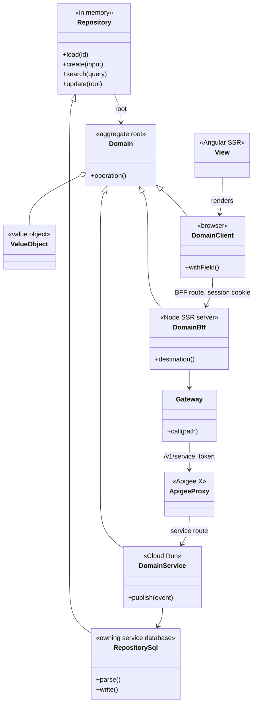
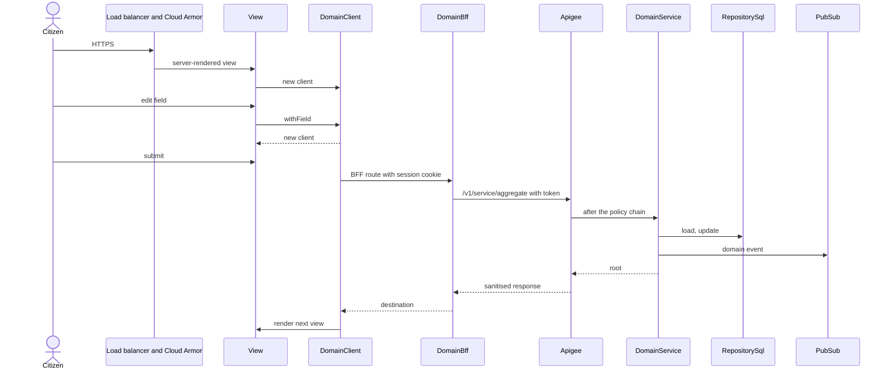

## Overview

Implementation fidelity for the **Government of Bermuda One-Stop Shop (OSS) Portal architecture**: an Angular
server-side-rendered portal with a Node Backend-for-Frontend, an Apigee X gateway in front of every service, and
microservices on Cloud Run that each own a Cloud SQL database, on Google Cloud in Canada. It applies to an
already-designed vertical slice — story map, module boundaries, and screens all exist before this tool runs.
Generate writes the acceptance tests first with Stories at `acceptance_tests` / `typescript`, then the production
code those tests drive. The rules below add to what Stories, Clean Engineering, and DDD already enforce.

**Source of every decision.** The architecture is taken from *OSS Portal: Operational Deliverable & Handover Pack*,
version 1.0 (31-07-2026), cited below as **the pack** with its section or procedure number (§3.2, OP-05, APP-04).
Where the pack is silent, this pattern carries the LERN pattern's choice (`patterns-lern-domain-driven`) and says so
under **Decisions the pack does not make**, so a reader can tell a Government-confirmed decision from a default.

**No fidelity progression of its own.** Every run pins `stories` at `acceptance_tests` with `format="typescript"`;
production code arrives through Stories' `ce()` companion at `code` / `typescript`.

**One aggregate, one folder — the LERN idea, spread over the OSS runtimes.** Each aggregate keeps every tier file in
one folder, exactly as LERN does. What changes is where each tier runs: the view, the client, and the
Backend-for-Frontend file are built into `citizen-portal-app`; the service and repository file are built into the
Cloud Run service that owns the aggregate. `{Domain}Client`, `{Domain}Bff`, and `{Domain}Service` all extend
`{Domain}`. `{Domain}Repository` is in-memory; `{Domain}RepositorySql` extends it and is the only class that writes the
owning service's database.

| Layer | File | Runs in | Role | Pack |
|---|---|---|---|---|
| Edge | — | Global external HTTPS load balancer, Cloud Armor | The only way in. No workload holds a public IP. | §2.2, §2.3 |
| View | `<screen-slug>.view.ts` | Browser, server-rendered by Angular SSR | `{Screen}View`. Holds the client. Paints fields and actions with Government Design System components. | §3.1, APP-04 |
| Client | `<aggregate>-client.ts` | Browser | `{Domain}Client`. Field changes return a new instance. Calls the Backend-for-Frontend only. | §3.2 |
| BFF routes | `<aggregate>-bff-routes.ts` | Node SSR server in `citizen-portal-app` | Parse the request. Call the BFF class. Return `destination`. | §3.2 |
| BFF | `<aggregate>-bff.ts` | Node SSR server | `{Domain}Bff` decides the next page and holds the session. `{Domain}Gateway` calls the aggregate's Apigee path with the token the server holds. | §3.2, §3.4 |
| Gateway | `<service>-proxy/` | Apigee X | One versioned base path per service, `/v1/<service>/**`, with the standard eight-policy chain. | §3.3 |
| Service routes | `<aggregate>-service-routes.ts` | Cloud Run service, internal ingress | Parse the gateway request. Call the service class. | §2.2, §3.1 |
| Service | `<aggregate>-service.ts` | Cloud Run service | `{Domain}Service` runs the domain operation and publishes its events. `{Domain}RepositorySql` reads and writes the service's own Cloud SQL database. | §3.1, §3.5 |
| Domain | `<aggregate>.ts` | Imported by every tier | `{Domain}`, `{SubDomain}`, domain events, in-memory `{Domain}Repository`. Framework-free. | — (LERN) |
| Store | `<service>` database, Cloud Storage bucket | Cloud SQL, Cloud Storage | One database per service. Payloads and attachments in Cloud Storage. | §3.5, D-02 |

1. The load balancer passes the request through Cloud Armor to `citizen-portal-app`.
2. Angular SSR renders the view for the current path; the view constructs `{Domain}Client` and paints its fields.
3. A field edit replaces the view's client with a new instance.
4. Submit calls the aggregate's BFF route with the session cookie — never a bearer token.
5. The BFF route builds `{Domain}Bff`, which reads the session and calls `{Domain}Gateway`.
6. `{Domain}Gateway` calls `/v1/<service>/<aggregate>/...` on Apigee with the citizen's token.
7. Apigee runs the policy chain (TLS, JWT, role and scope, spike arrest, JSON threat protection, routing, error
   sanitisation, audit log) and routes to the service.
8. The service route builds `{Domain}Service`, which runs the domain operation on the root it loads through
   `{Domain}RepositorySql`, writes the service's database, and publishes any event to Pub/Sub.
9. The BFF route asks `{Domain}Bff.destination` and returns that path; Angular renders the next view.





---

## Guidance

Enforceable rules live in **§ Shared rules** below. This section explains how they apply; do not treat guidance
bullets as a second rule list.

### Domain-driven design (reference)

The tiers are DDD tactics on the OSS runtimes. Stereotypes, invariants, and repository seams come from
[`practices/ddd/ddd.md`](../../practices/ddd/ddd.md) **model** and **tactics**; this pattern says only how they land
on Cloud Run, Apigee, and Cloud SQL.

A **bounded context is a service.** The pack gives each service its own database and its own schema, and lets no
service read another's tables (§3.5); a new data store is "a database owned by a single service" (APP-04 step 4).
That is the definition of a bounded context, so each Cloud Run service is one, and the aggregates inside it share
that service's database. The services in production are:

| Service (bounded context) | Owns | Class | Pack |
|---|---|---|---|
| `identity-service` | Citizen and administrative profiles, onboarding, authorisation decisions, family and guardian relationships | Tier 1 | §3.1, §7.1 |
| `system-config-service` | Content and settings, error catalogue, communication templates, reference data | Tier 2 | §3.1 |
| `summer-camp-service` | Application-to-seat lifecycle, lottery allocation, payment linkage | Tier 2 | §3.1 |
| `mdu-service` | Ministry departmental use-case processing | Tier 2 | §3.1 |

A new ministry service is a new bounded context with its own Cloud Run service, its own database, and its own Apigee
base path (APP-04).

---

### Layout: service, aggregate, portal app

Each aggregate's files live under `src/<service>/<aggregate>/`, as LERN keeps them under
`src/<boundedContext>/<aggregate>/`. The service folder holds what is common to the service — its Cloud Run boot,
its Apigee proxy, and its migrations. `packages/citizen-portal-app/` holds the portal's boot and what is common
across the three portals.

```
src/
  <service>/                              ← one Cloud Run service = one bounded context (§3.1, §3.5)
    <service>-app.ts                      ← Cloud Run boot: internal ingress, mounts every aggregate's service routes
    <service>-proxy/                      ← Apigee X proxy for /v1/<service>/** with the standard policy chain (§3.3)
    migrations/                           ← expand, migrate-and-backfill, and contract steps for this service's schema (APP-14)
    <aggregate>/
      <aggregate>.ts                      ← {Domain}, {SubDomain}, domain events, in-memory {Domain}Repository
      <aggregate>-service.ts              ← {Domain}Service; {Domain}RepositorySql writes this service's database
      <aggregate>-service-routes.ts       ← the aggregate's routes on the Cloud Run service
      <aggregate>-bff.ts                  ← {Domain}Bff, {Domain}Gateway — run in the portal's Node SSR server
      <aggregate>-bff-routes.ts           ← the aggregate's routes on the Backend-for-Frontend
      <aggregate>-client.ts               ← {Domain}Client, the browser client the views render
      <aggregate>-paths.ts                ← the aggregate's browser paths
      <screen-slug>.view.ts               ← views for this aggregate

packages/citizen-portal-app/              ← the one portal deployable (§3.1)
  server.ts                               ← Angular SSR and the Node BFF: session middleware, mounts every aggregate's BFF routes
  main.ts / app.config.ts                 ← browser boot
  citizen/ operator/ admin/               ← the three portals: router, shell, and frames that compose step views
  package.json
```

A form is "an isolated module in the frontend monorepo" (APP-04 step 2): here that module is the aggregate folder's
views, client, and BFF files, which `citizen-portal-app` imports through `@src`. Withdrawing one form does not
affect the others because nothing outside its folder imports its files (APP-04 rollback).

Rule `aggregate-folder-holds-every-tier` governs the split, and `screens-live-in-their-domain` keeps step views out
of the portal package.

---

### Experience tier: the Backend-for-Frontend is the only way in

The pack makes this a configuration fact, not a convention: service-tier Cloud Run services use internal ingress,
only the BFF service account may invoke the gateway path, and the browser holds an opaque `HttpOnly`, `Secure`,
`SameSite=Lax` session cookie (§3.2). So:

- `{Domain}Client` calls only BFF routes. It never calls Apigee or a service, and never sees a bearer token.
- `{Domain}Bff` keeps the citizen's token on the server, in the session, and hands it to `{Domain}Gateway`.
- `{Domain}Bff.destination` maps the domain step to a browser path, as LERN's `{Domain}Node.destination` does. BFF
  routes ask it and return the path.
- Server-side rendering has to produce complete pages: a rendering failure shows as a partly blank page, not an
  error (APP-09 step 5), so a view renders from what the client holds and does not fetch on its own.

Rules `browser-calls-only-the-bff`, `tokens-stay-on-the-server`, `bff-decides-next-page`, and `views-render-only`
govern this tier.

---

### Gateway: one proxy per service, one policy chain for all

Apigee X mediates every cross-boundary call (§3.1). Each service has one proxy with a versioned base path
(`/v1/identity/**`, `/v1/summer-camp/**`, `/v1/mdu/**`, `/v1/config/**`, and `/v1/integration/**` for internal
orchestration only), and every proxy applies the same chain in the same order (§3.3):

1. TLS and mutual authentication
2. JWT validation — signature against the issuer's JWKS; issuer, audience, expiry, not-before, and subject claims
3. Role and scope enforcement per proxy path
4. Spike arrest
5. JSON threat protection — payload size, depth, array length
6. Target routing
7. Error sanitisation — no stack trace, host name, internal address, or SQL fragment reaches a client
8. Audit logging with a trace identifier

A new form "does not get its own security model" (APP-04 step 3). A breaking change to a path is a new major version
with a deprecation window, never an in-place change (APP-05 step 3).

Rules `one-proxy-per-service`, `standard-policy-chain`, and `version-breaking-changes` govern the gateway.

---

### Service tier and persistence: one database per service

`{Domain}Repository` on `<aggregate>.ts` is the in-memory collection: `load`, `create`, `search`, `update` on the
aggregate root, named in ubiquitous language, as in LERN. `{Domain}RepositorySql` on `<aggregate>-service.ts`
extends it, parses what it reads, and is the only class that touches the aggregate's tables in the owning service's
Cloud SQL database.

| Store | Holds | Pack |
|---|---|---|
| Cloud SQL, one database per service | Relational data for that service's aggregates. Point-in-time recovery. | §3.5, D-02, §7.2 |
| Cloud Storage | Form payloads and citizen attachments. Uniform bucket-level access, object versioning, customer-managed keys, retention policy. | §3.5, APP-11 |
| Memorystore | Session and reference caching only. Holds nothing authoritative; flushing it loses no data. | §3.5 |
| BigQuery | Curated replication for cross-ministry reporting, so reports never load the transactional databases. | §3.5, APP-10 |

Data another service owns is obtained by calling that service's API through Apigee — never by reading its tables
(§3.5). Restoring one service's database does not restore consistency with another, so a story that spans services
states how each side recovers (§7.2).

Schema changes follow **expand and contract** (APP-14): an expand step is additive only; backfill runs as a
controlled job, not at start-up; a contract step ships only after the release that needed the old structure is
retired; and a destructive migration never ships in the same release as application code.

Rules `one-database-per-service`, `no-cross-service-tables`, `repository-owns-aggregate-lifecycle`,
`attachments-in-cloud-storage`, `cache-holds-nothing-authoritative`, and `expand-and-contract-migrations` govern this
tier.

---

### Events and notifications

Notifications go out as Pub/Sub events from the service that owns the transaction. Subscribers are idempotent, so a
replay after a fix is safe, and every subscription has a dead-letter topic (APP-07). The transaction is
authoritative; the notification is a courtesy, so a failed notification never undoes or blocks the transaction
(APP-07 step 5).

Rules `publish-events-from-the-owning-service` and `idempotent-subscribers` govern events.

---

### Identity

| Population | Authority | What the code does | Pack |
|---|---|---|---|
| Citizens and residents | Cloud Identity Platform | The BFF signs the citizen in and holds the token; Apigee validates it. | §2.3, §3.4 |
| Government workforce | Microsoft Entra ID over OIDC | Roles come only from Entra group claims. The portal has no switch of its own that grants access. | §3.4, D-04, APP-02 |
| Workloads | GCP service accounts | Keyless where possible; no downloaded key material. | §3.4 |

Email addresses in `gov.bm` and its subdomains are reserved for administrative and ministry-operator access. The
rule is checked at four independent layers — client validation, the BFF before any identity-provider redirect,
`identity-service` before a profile is written, and the citizen directory's blocked-domain list. A rejection at the
third or fourth layer is a security finding, not a validation error (§3.4).

Rules `staff-roles-from-entra-claims` and `gov-bm-blocked-at-four-layers` govern identity.

---

### Content is configuration, rules are code

Wording, reference data, error text, and notification templates live in `system-config-service` and change without
a code release (APP-03). Validation logic and eligibility rules are code and change through a release (APP-03 step
1). So a view takes its text from configuration, and an aggregate's business rules stay on the domain class.

Rule `content-from-system-config` governs this split.

---

### Integration with legacy systems

Integration goes through Google Application Integration on `/v1/integration/**`, which is internal only and never
exposed to the citizen portal (§3.3). The approved systems are JD Edwards, Document Management, Dynamics 365, and the
legacy database; anything else is a change request (APP-04 step 1). Spike arrest and quota on these paths exist to
protect on-premise systems with limited capacity (APP-05 step 4). The HA VPN to on-premise is marked *currently not
applicable* in the pack (OP-10), so a story that needs a legacy system records that the connection is not yet built.

Rule `integrate-through-application-integration` governs this tier.

---

### Security and data handling in code

- Secrets come from Secret Manager and are resolved at start-up, not cached forever, so rotation works by redeploy
  (OP-08).
- Every data store uses customer-managed encryption keys (§2.3).
- Logs pass a PII masking processor before storage; code still never logs identifiers, payment data, or contact
  details on purpose (§2.3, OP-15).
- Errors reach a client only as the uniform sanitised contract (§3.3, step 7).

Rules `secrets-from-secret-manager` and `no-personal-data-in-logs` govern these.

---

### Delivery pattern

The pack fixes how every change reaches production (§6.4, OP-05). The code this pattern generates has to fit it.

| Practice | What it means for generated code | Pack |
|---|---|---|
| Build once, promote the digest | One container image per deployable, promoted by digest through each environment. Never rebuild for an environment; environment differences are configuration. | OP-05 step 2, Appendix B |
| Branch from production | Feature branches are cut from `prod` and promoted dev → uat → prod in order. No cherry-picking past a gate. | §6.4 |
| Pipeline only | No console edits, direct deployments, or manual database changes. Infrastructure is code (GitOps). | §2.1, §6.4 |
| Canary release | A new Cloud Run revision takes a small share of traffic, then all of it. Rollback moves traffic to the previous revision in under ten minutes, so a release never depends on a schema change it cannot run without. | OP-05 steps 5–6 |
| Security gate | A High or Critical finding in a container image stops the pipeline. | OP-09 step 4 |
| Change classes | Standard (content, thresholds), normal (release, schema expand, routing), security-affecting (policy chain, Cloud Armor, IAM), emergency (through the pipeline, back-merged the same day). | §6.4 |
| Asset fingerprinting | Changed frontend assets carry new filenames, so a release needs little cache invalidation. | APP-09 step 2 |

**Every new service or form is registered.** A service missing from the service inventory, the alert inventory, or
the service-class table "is unmonitored and unrecoverable" (APP-04 step 6). Generate records, for each new service or
aggregate:

| Register | What to record | Pack |
|---|---|---|
| Service inventory | Component, runtime, responsibility | §3.1 |
| Alerts | Its own indicators: 5xx ratio, P95 latency, dead-letter depth where it publishes | §6.3 |
| Service class | Tier 1, 2, or 3, chosen by what becomes unavailable when it stops | §7.1 |

| Class | Definition | Availability | Max data loss (RPO) | Max time to restore (RTO) |
|---|---|---|---|---|
| Tier 1 | Citizen-facing; without it no service is reachable | 99.9% | 15 min | 4 h |
| Tier 2 | One service unavailable while others continue | 99.5% | 1 h | 8 business h |
| Tier 3 | Analytical or internal; citizens unaffected | 99.0% | 24 h | 48 h |

The pack marks these values as proposed, awaiting Government confirmation (§7.1).

Platform naming the code and its infrastructure follow: projects `<env>-<domain>-<service>` (production portal:
`prj-gob-ss-oss-portal-p`), the five mandatory labels `environment`, `ministry`, `owner`, `cost-center`,
`data-classification`, and the approved regions `northamerica-northeast1` (Montréal) and `northamerica-northeast2`
(Toronto) (§2.1, §2.2).

Rules `build-once-promote-digest`, `revision-rollback-safe`, `register-every-service`, and
`label-every-resource` govern delivery.

---

### Testing architecture

The pack sets what has to be proven before production — Ministry SME acceptance in UAT against the business
requirements (APP-04 step 5), a rehearsal of every migration on a production-scale dataset (APP-14), and a
representative citizen journey end to end after every release (OP-05 step 6, APP-09 step 6) — but not how the tests
are written. The test layout is carried from LERN: each sub-epic folder under `tests/<epic-slug>/<sub-epic-slug>/`
states each story once and runs it on every tier.

| File | Runs on | Proves |
|---|---|---|
| `<snake>.story.shared.ts` | Nothing — it states the story | One Given, When, Then for every tier |
| `<snake>.story.domain.spec.ts` | `{Domain}` and the in-memory `{Domain}Repository` | The aggregate's rules |
| `<snake>.story.service.spec.ts` | `{Domain}Service` and `{Domain}RepositorySql` on a throwaway database | The service and its schema, with nothing stubbed |
| `<snake>.story.bff.spec.ts` | `{Domain}Bff` with the gateway answered from examples | Session, token custody, and `destination` |
| `<snake>.story.playwright.ts` | The rendered portal | What a person sees and does on a screen |
| `<snake>.journey.e2e.ts` | The whole path: portal, BFF, Apigee, service, database | The representative citizen journey the pack verifies after every release |

### UX hand-off

Screens and navigation for this slice were designed upstream by `ux` before this tool runs, using Government Design
System components (APP-04 step 2). `generate` cites that artifact under **Sources / context** on the touched view
files; it does not call `ux` itself.

### Generating stories — work that spans aggregates

Inside one service, aggregates share a database but keep separate roots. Across services the pack decides the
coordination: data by API call through Apigee (§3.5) and reactions by Pub/Sub event (APP-07). Before writing
scenarios that span aggregates **inside one service**, ask how they coordinate (rule `ask-cross-aggregate-sync`).

Use the **AskQuestion** tool. One question, two options; do not write story files until the answer is in
`.context/grill-answers.md` under the heading **Cross-aggregate sync**.

- **prompt:** This slice touches more than one aggregate in the same service. How should stories coordinate work that
  spans them?
- **options:**
  1. **Domain events** — the acting aggregate publishes a past-tense event; the other aggregate loads its own root and
     applies its reaction.
  2. **The service orchestrates** — `{Domain}Service` calls each aggregate's repository in turn, inside one request.

If the slice is a single aggregate, record `single-aggregate` under that heading and skip the question.

---

### Decisions the pack does not make

These are carried from the LERN pattern so code can be generated; each is open for the Government and Abacus to
confirm against the maintained repositories the pack cites (§3.6).

| Decision | Carried choice | Why it is open |
|---|---|---|
| Service language and framework | TypeScript on Node, Express routes | The pack gives controller and endpoint counts (§3.1) but no language. |
| Validation library | Zod, parsed in `{Domain}RepositorySql` and in the BFF | Not named in the pack. |
| Cloud SQL engine | Whatever the services use; tests run a throwaway database of the same engine | The pack says Cloud SQL without an engine (§3.5). |
| Test layout | LERN's shared-story tiers | The pack reports test counts and coverage (§3.1) but not structure. |
| Repository layout | One monorepo with `src/<service>/<aggregate>/` and `packages/citizen-portal-app/` | The pack says the frontend is a shared monorepo (§3.1) but not where services live. |
| Staging environment | Treated as the pre-production environment migrations are rehearsed in | §6.4 names dev, uat, and prod; OP-05 and APP-14 name Staging. |

## Generate

Content is held to this pattern when the `.context/patterns.md` at the root of its folder names it. Generate in a
session that overlays this pattern records it there.

1. Follow **session_guidance**. Scaffold each aggregate under `src/<service>/<aggregate>/` with every tier file, the
   service's boot, proxy, and migrations folder under `src/<service>/`, and the portal boot and the three portals under
   `packages/citizen-portal-app/`. Import aggregates into the portal through `@src`.
2. **`ask-cross-aggregate-sync`** — if more than one aggregate in one service is in play, ask as described above and
   save the answer **before** calling the Stories companion.
3. Call guidance on the Stories companion. For each sub-epic write `<snake>.story.shared.ts`, the domain, service, and
   BFF specs that run it, `examples/`, the Playwright screen story for every story a person does on a screen, and the
   journey test. Specs first — small RED cycles before production code.
4. Record each new service or aggregate in the service inventory, alert, and service-class registers (rule
   `register-every-service`).
5. Cite the ux screen and navigation artifact under **Sources / context** on the touched view files.
6. Run validate. If it fails, fix and validate again until it passes.

## Shared rules

```yaml
alwaysApply: false
globs: "packages/citizen-portal-app/**/*,src/**/*-service.ts,src/**/*-service-routes.ts,src/**/*-bff.ts,src/**/*-bff-routes.ts,src/**/*-client.ts,src/**/*.view.ts,src/**/*-proxy/*,src/**/*-proxy/**/*,src/**/migrations/*,src/**/*-app.ts"
```

With this pattern overlaid, the knowledge graph checks the rules the code alone can show — the browser, BFF, and
service tier files, each service's Apigee proxy and migrations, and the service and journey test files (`graph_overlay.py`,
`practices/ddd/rules/`, `practices/stories/rules/`). The rest are checked by validate reading the code and the registers.

Whenever you create, alter, or delete an aggregate folder under `src/<service>/`, a service's boot, proxy, or
migrations, the portal app under `packages/citizen-portal-app/`, or tests they support, follow these rules. Each rule
names the pack section it comes from; a rule marked *(LERN)* is carried from the LERN pattern.

If this change will not stay here, follow `practices/clean-engineering/clean-engineering-code.mdc`. If the tests are
Spec-by-Example, also follow `practices/stories/stories-acceptance-tests.mdc`. The `practices/ddd/ddd-tactics.mdc`
rules apply to domain classes.

### Layout and tiers

- **`aggregate-folder-holds-every-tier`** — Keep every tier file of an aggregate in `src/<service>/<aggregate>/`: `<aggregate>.ts`, `-service.ts`, `-service-routes.ts`, `-bff.ts`, `-bff-routes.ts`, `-client.ts`, `-paths.ts`, and its views. One place per aggregate means a form is an isolated module that can be withdrawn without touching others (APP-04). *(LERN layout)*
- **`service-is-the-bounded-context`** — Put an aggregate under the one service that owns its data, and give a new bounded context its own Cloud Run service, database, and Apigee base path, because each service owns its schema and no other may read it (§3.5, APP-04 step 4).
- **`screens-live-in-their-domain`** — A step view lives in its aggregate folder. `packages/citizen-portal-app/` holds only boot, the three portals' routers and shells, and frames that compose step views, so a portal change never edits an aggregate (§3.1). *(LERN)*
- **`tier-classes-extend-the-domain`** — `{Domain}Client`, `{Domain}Bff`, and `{Domain}Service` extend `{Domain}` and keep every inherited operation unchanged, so a rule written once runs the same in the browser, the BFF, and the service. *(LERN)*
- **`maintain-layer-purity`** — `<aggregate>.ts` imports no Angular, Express, database driver, or Google Cloud client. Browser files never import `-bff.ts` or `-service.ts`; BFF files never import `-service.ts`. A cross-import would ship server code or credentials into the wrong runtime. *(LERN)*

### Experience tier

- **`browser-calls-only-the-bff`** — `{Domain}Client` calls only BFF routes on the portal's own origin; it never calls an Apigee path or a service URL. Services use internal ingress, so a direct call fails in production anyway (§3.2).
- **`tokens-stay-on-the-server`** — The browser holds only the opaque `HttpOnly`, `Secure`, `SameSite=Lax` session cookie. No bearer token in a client file, in browser storage, or in a server-rendered page, because client-side script must never read one (§3.2).
- **`bff-decides-next-page`** — `{Domain}Bff.destination` maps the domain step to the browser path; BFF routes return it and the router renders that view. Path maps stay in `-bff.ts` and paths in `-paths.ts`. *(LERN `node-decides-next-page`)*
- **`views-render-only`** — A view renders the client it holds with Government Design System components and fetches nothing itself, so server-side rendering always produces a complete page (§3.1, APP-04 step 2, APP-09 step 5).
- **`gov-bm-blocked-at-four-layers`** — A citizen sign-up or sign-in rejects `gov.bm` and its subdomains in the client, in the BFF before any identity-provider redirect, and in `identity-service` before a profile is written; the directory's blocked-domain list is the fourth layer. A rejection in the service is logged as a security finding, not returned as a validation error (§3.4).
- **`staff-roles-from-entra-claims`** — Operator and administrator roles come only from Entra ID group claims in the token. No table, flag, or screen in the portal grants a staff role, because access is granted and revoked in Entra (§3.4, APP-02).

### Gateway

- **`one-proxy-per-service`** — Each service has one Apigee proxy at `/v1/<service>/**` in `src/<service>/<service>-proxy/`. `/v1/integration/**` is internal and never reachable from the portal (§3.3).
- **`standard-policy-chain`** — Every proxy applies the eight policies in the pack's order: TLS and mutual authentication, JWT validation, role and scope, spike arrest, JSON threat protection, routing, error sanitisation, audit logging. Removing or reordering one is a security change that needs the Security and Compliance Lead (§3.3, APP-05).
- **`version-breaking-changes`** — A breaking change to a path is a new major version (`/v2/...`) with a deprecation window, never an edit to `/v1`, so existing callers keep working (APP-05 step 3).
- **`sanitised-errors-only`** — Services fail with the uniform error contract and an error-catalogue code from `system-config-service`; no stack trace, host name, internal address, or SQL fragment in a response body (§3.1, §3.3).

### Services and persistence

- **`one-database-per-service`** — A service's aggregates live in that service's Cloud SQL database. `{Domain}RepositorySql` extends the in-memory `{Domain}Repository` and is the only class that reads or writes the aggregate's tables (§3.5). *(LERN `one-repository-per-aggregate`)*
- **`no-cross-service-tables`** — Data another service owns is fetched through that service's Apigee path, never by connecting to its database, so each service can be restored and changed on its own (§3.5, §7.2).
- **`repository-owns-aggregate-lifecycle`** — `{Domain}Repository` offers `load`, `create`, `search`, `update` on the root, named in ubiquitous language; services and routes never write SQL themselves. *(LERN)*
- **`attachments-in-cloud-storage`** — Form payloads and citizen attachments go to Cloud Storage with object versioning, not into Cloud SQL; the database keeps the object reference (§3.5, D-02).
- **`cache-holds-nothing-authoritative`** — Memorystore holds only session and reference data that can be rebuilt; no transaction or state is kept only in the cache, because operators may flush it at any time (§3.5).
- **`reporting-reads-bigquery`** — Reports and extracts read the BigQuery replica, never the transactional databases, so reporting load cannot slow citizen journeys (§3.5, APP-10).
- **`expand-and-contract-migrations`** — Every schema change is one migration in `src/<service>/migrations/` marked expand, migrate-and-backfill, or contract. Expand is additive only; backfill is a controlled job, not start-up code; contract ships separately, after the release that needed the old structure is retired (APP-14).
- **`revision-rollback-safe`** — Application code never needs a schema change from the same release, so moving traffic back to the previous Cloud Run revision always works (OP-05, APP-14 step 5).

### Events, integration, content

- **`publish-events-from-the-owning-service`** — Only the service that owns a transaction publishes its Pub/Sub event, after the transaction commits. A notification failure never undoes the transaction (APP-07).
- **`idempotent-subscribers`** — Every subscriber handles the same event twice with the same result, and every subscription has a dead-letter topic, so a replay after a fix is safe (APP-07 step 4).
- **`integrate-through-application-integration`** — Calls to JD Edwards, Document Management, Dynamics 365, or the legacy database go through Application Integration on `/v1/integration/**`. A service never connects to a legacy system directly; any other system is a change request (§3.3, APP-04 step 1).
- **`content-from-system-config`** — Citizen-facing wording, error text, reference data, and notification templates come from `system-config-service`, so ministries change them without a release. Validation and eligibility rules stay in code on the domain class (APP-03).

### Security and data handling

- **`secrets-from-secret-manager`** — Credentials come from Secret Manager at start-up; none in code, configuration files, or environment files committed to the repository, and no downloaded service-account keys (§2.3, §3.4, OP-08).
- **`no-personal-data-in-logs`** — Logs carry the trace identifier and record identifiers only; never names, contact details, payment data, or document contents (§2.3, OP-15).
- **`least-data-in-responses`** — A service returns only the fields the calling screen needs, because support staff and screens see only what the task requires (APP-01 notes, APP-10).

### Delivery

- **`build-once-promote-digest`** — One container image per deployable, with no environment-specific build step; everything that differs by environment is configuration resolved at start-up, so the digest tested in UAT is the one in production (OP-05 step 2).
- **`register-every-service`** — A new service or aggregate adds its entry to the service inventory, its alerts (5xx ratio, P95 latency, dead-letter depth where it publishes), and its service class, because an unregistered service is unmonitored and unrecoverable (APP-04 step 6, §6.3, §7.1).
- **`label-every-resource`** — Every infrastructure resource carries `environment`, `ministry`, `owner`, `cost-center`, and `data-classification`, sits in `northamerica-northeast1` or `northamerica-northeast2`, and has no public IP (§2.1, §2.2).

### Testing

- **`reduce-story-overlap`** — Each sub-epic states each story once in `<snake>.story.shared.ts`; the domain, service, and BFF specs run it. A tier adds a scenario only for what the shared story cannot see. *(LERN)*
- **`service-tier-runs-a-real-database`** — The service spec runs `{Domain}RepositorySql` against a throwaway database of the production engine with the service's migrations applied, so the schema is tested with the code. *(LERN `server-tier-calls-the-real-thing`)*
- **`journey-test-per-release`** — Each sub-epic a citizen completes has an end-to-end journey test through the portal, BFF, Apigee, and service, because the pack verifies every release with a representative citizen journey (OP-05 step 6, APP-09 step 6).
- **`no-expect-in-given`** — A Given sets up state; it does not assert. Checks belong in a Then. *(LERN)*
- **`outline-entries-loop-over-examples`** — A Scenario Outline runs as `examples.forEach(row => scenario(...))` over its examples export; never hand-write one scenario per example entry, which silently drops the others. *(LERN)*
- **`scaffold-test-scripts`** — `scripts/test.sh`, `test.ps1`, `test-e2e.sh`, `test-e2e.ps1` at the workspace root; Vitest and Playwright stay separate. *(LERN)*
- **`ask-cross-aggregate-sync`** — **Hard gate** when generating stories that span aggregates in one service. Use AskQuestion and save the answer under **Cross-aggregate sync** in `.context/grill-answers.md` before writing story files. *(LERN)*
